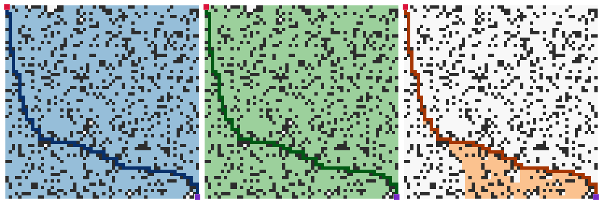
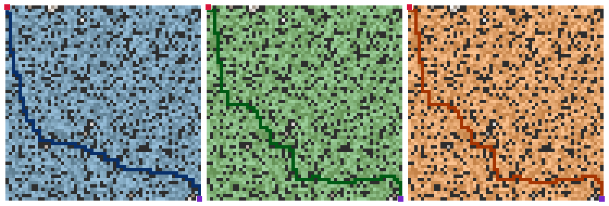
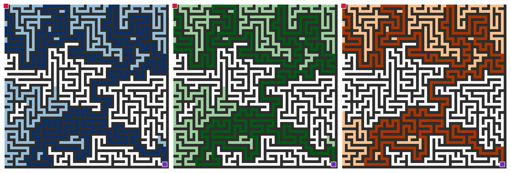
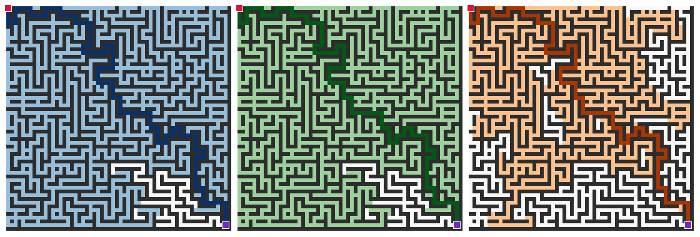
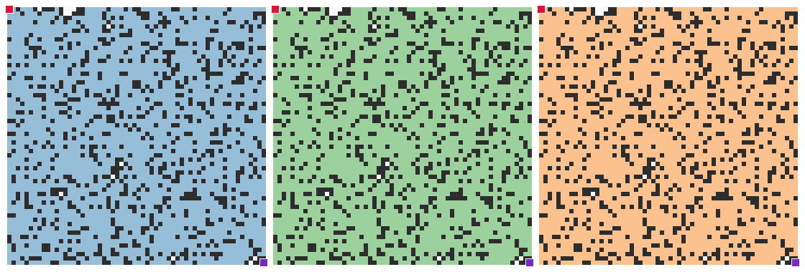
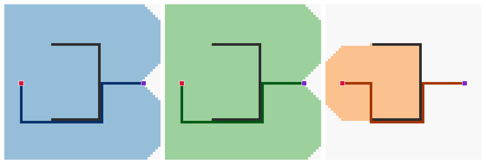
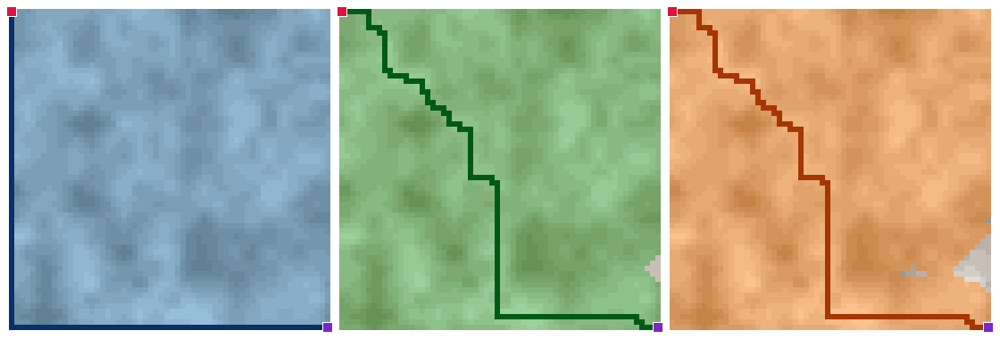
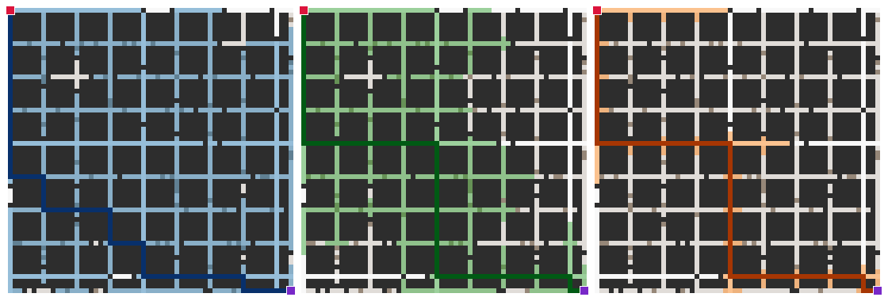

# Explored cells

Generated by `make figures`. Map size 60 x 60, seed 2026.

Each figure shows, left to right: **BFS | Dijkstra | A***.

| Color | Meaning |
| --- | --- |
| dark gray | wall |
| white -> warm gray | open cell, cost 1 -> 9 |
| light blue / green / orange | cells expanded by BFS / Dijkstra / A* |
| dark blue / green / orange | path returned |
| red / purple | start / goal |

Times are a single run made while drawing, for reference only. The numbers used for comparison are the experiment results in `results/`.

## Random obstacles 20%, unit cost

| | path cost | moves | expanded | max frontier | time (ms) |
| --- | ---: | ---: | ---: | ---: | ---: |
| BFS | 118 | 118 | 2826 | 53 | 2.15 |
| Dijkstra | 118 | 118 | 2826 | 53 | 7.61 |
| A* | 118 | 118 | 431 | 269 | 1.93 |

## Random obstacles 20%, cost 1-9 (same walls as above)

| | path cost | moves | expanded | max frontier | time (ms) |
| --- | ---: | ---: | ---: | ---: | ---: |
| BFS | 568 | 118 | 2826 | 53 | 3.50 |
| Dijkstra | 442 | 124 | 2826 | 74 | 8.11 |
| A* | 442 | 124 | 2826 | 99 | 10.55 |

## Perfect maze (exactly one path)

| | path cost | moves | expanded | max frontier | time (ms) |
| --- | ---: | ---: | ---: | ---: | ---: |
| BFS | 628 | 628 | 1165 | 5 | 1.54 |
| Dijkstra | 628 | 628 | 1165 | 5 | 3.22 |
| A* | 628 | 628 | 1048 | 6 | 3.67 |

## Maze with loops (10% extra openings)

| | path cost | moves | expanded | max frontier | time (ms) |
| --- | ---: | ---: | ---: | ---: | ---: |
| BFS | 156 | 156 | 1754 | 29 | 2.43 |
| Dijkstra | 156 | 156 | 1754 | 29 | 4.25 |
| A* | 156 | 156 | 1199 | 43 | 4.06 |

## No path (goal sealed off)

| | path cost | moves | expanded | max frontier | time (ms) |
| --- | ---: | ---: | ---: | ---: | ---: |
| BFS | no path | - | 2824 | 53 | 3.40 |
| Dijkstra | no path | - | 2824 | 53 | 7.82 |
| A* | no path | - | 2824 | 1039 | 16.35 |

## U-shaped wall (A* trap)

| | path cost | moves | expanded | max frontier | time (ms) |
| --- | ---: | ---: | ---: | ---: | ---: |
| BFS | 77 | 77 | 3443 | 71 | 4.48 |
| Dijkstra | 77 | 77 | 3443 | 71 | 19.40 |
| A* | 77 | 77 | 1037 | 102 | 3.81 |

## Terrain (cost 1-9 in patches)

| | path cost | moves | expanded | max frontier | time (ms) |
| --- | ---: | ---: | ---: | ---: | ---: |
| BFS | 538 | 118 | 3600 | 60 | 4.50 |
| Dijkstra | 375 | 118 | 3591 | 101 | 11.00 |
| A* | 375 | 118 | 3550 | 160 | 31.04 |

## City blocks (arterial 1, local road 3, jam 9)

| | path cost | moves | expanded | max frontier | time (ms) |
| --- | ---: | ---: | ---: | ---: | ---: |
| BFS | 266 | 118 | 975 | 21 | 1.11 |
| Dijkstra | 124 | 118 | 644 | 30 | 1.77 |
| A* | 124 | 118 | 225 | 36 | 1.17 |
