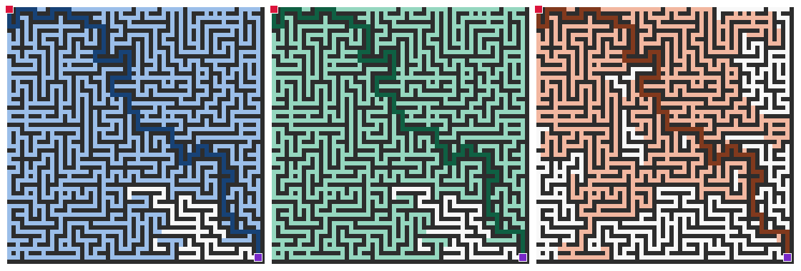
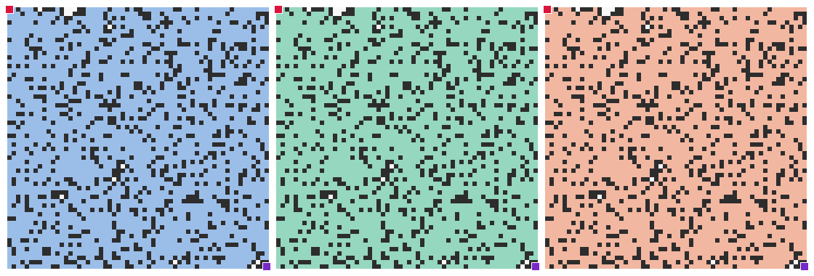
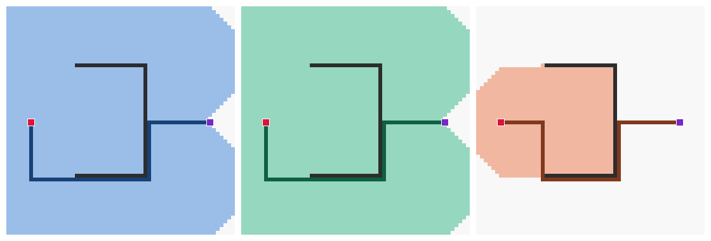

# Explored cells

Generated by `make figures`. Map size 60 x 60, seed 2026.

Each figure shows, left to right: **BFS | Dijkstra | A***.

| Color | Meaning |
| --- | --- |
| dark gray | wall |
| white -> warm gray | open cell, cost 1 -> 9 |
| light blue / aqua / orange | cells expanded by BFS / Dijkstra / A* |
| dark blue / aqua / orange | path returned |
| red / purple | start / goal |

Times are a single run made while drawing, for reference only. The numbers used for comparison are the experiment results in `results/`.

## Random obstacles 20%, unit cost

| | path cost | moves | expanded | max frontier | time (ms) |
| --- | ---: | ---: | ---: | ---: | ---: |
| BFS | 118 | 118 | 2826 | 53 | 3.84 |
| Dijkstra | 118 | 118 | 2826 | 53 | 6.71 |
| A* | 118 | 118 | 431 | 269 | 1.12 |

## Random obstacles 20%, cost 1-9 (same walls as above)

| | path cost | moves | expanded | max frontier | time (ms) |
| --- | ---: | ---: | ---: | ---: | ---: |
| BFS | 568 | 118 | 2826 | 53 | 2.51 |
| Dijkstra | 442 | 124 | 2826 | 74 | 4.58 |
| A* | 442 | 124 | 2826 | 99 | 5.82 |

## Perfect maze (exactly one path)

| | path cost | moves | expanded | max frontier | time (ms) |
| --- | ---: | ---: | ---: | ---: | ---: |
| BFS | 628 | 628 | 1165 | 5 | 0.99 |
| Dijkstra | 628 | 628 | 1165 | 5 | 2.70 |
| A* | 628 | 628 | 1048 | 6 | 1.74 |

## Maze with loops (10% extra openings)

| | path cost | moves | expanded | max frontier | time (ms) |
| --- | ---: | ---: | ---: | ---: | ---: |
| BFS | 156 | 156 | 1754 | 29 | 1.66 |
| Dijkstra | 156 | 156 | 1754 | 29 | 2.48 |
| A* | 156 | 156 | 1199 | 43 | 4.28 |

## No path (goal sealed off)

| | path cost | moves | expanded | max frontier | time (ms) |
| --- | ---: | ---: | ---: | ---: | ---: |
| BFS | no path | - | 2824 | 53 | 2.66 |
| Dijkstra | no path | - | 2824 | 53 | 4.32 |
| A* | no path | - | 2824 | 1039 | 7.23 |

## U-shaped wall (A* trap)

| | path cost | moves | expanded | max frontier | time (ms) |
| --- | ---: | ---: | ---: | ---: | ---: |
| BFS | 77 | 77 | 3443 | 71 | 2.59 |
| Dijkstra | 77 | 77 | 3443 | 71 | 5.57 |
| A* | 77 | 77 | 1037 | 102 | 2.07 |

## Terrain (cost 1-9 in patches)

| | path cost | moves | expanded | max frontier | time (ms) |
| --- | ---: | ---: | ---: | ---: | ---: |
| BFS | 538 | 118 | 3600 | 60 | 4.59 |
| Dijkstra | 375 | 118 | 3591 | 101 | 5.94 |
| A* | 375 | 118 | 3550 | 160 | 7.36 |

## City blocks (arterial 1, local road 3, jam 9)

| | path cost | moves | expanded | max frontier | time (ms) |
| --- | ---: | ---: | ---: | ---: | ---: |
| BFS | 266 | 118 | 975 | 21 | 0.85 |
| Dijkstra | 124 | 118 | 644 | 30 | 0.98 |
| A* | 124 | 118 | 225 | 36 | 0.45 |

# 8 directions and Jump Point Search

Left to right: **Dijkstra | A* (octile distance) | JPS**. Costs are in 8-direction units (straight 10, diagonal 14).

In the JPS panel the magenta tint marks cells JPS only *looked at* while jumping, and the black squares are the jump points it actually put on the heap.

## 8 directions: random obstacles 20%

| | path cost | expanded (JPS: jump points) | scanned while jumping | time (ms) |
| --- | ---: | ---: | ---: | ---: |
| Dijkstra | 958 | 2826 | - | 8.02 |
| A* | 958 | 1186 | - | 4.58 |
| JPS | 958 | 640 | 4838 | 7.54 |

## 8 directions: U-shaped wall

| | path cost | expanded (JPS: jump points) | scanned while jumping | time (ms) |
| --- | ---: | ---: | ---: | ---: |
| Dijkstra | 614 | 3290 | - | 9.77 |
| A* | 614 | 924 | - | 5.07 |
| JPS | 614 | 7 | 3831 | 4.02 |

## 8 directions: city blocks, every road cost 1

| | path cost | expanded (JPS: jump points) | scanned while jumping | time (ms) |
| --- | ---: | ---: | ---: | ---: |
| Dijkstra | 1180 | 975 | - | 2.59 |
| A* | 1180 | 766 | - | 2.25 |
| JPS | 1180 | 68 | 1003 | 1.14 |

## 8 directions: maze with loops

| | path cost | expanded (JPS: jump points) | scanned while jumping | time (ms) |
| --- | ---: | ---: | ---: | ---: |
| Dijkstra | 1560 | 1754 | - | 2.95 |
| A* | 1560 | 1408 | - | 5.38 |
| JPS | 1560 | 436 | 1694 | 2.74 |
