# Experiment results

Generated by `make analyze` from the raw data in `results/`. Times are medians over 10 maps x 5 runs with the interquartile range (IQR) in brackets.

Measured on GitHub Codespaces: AMD EPYC 7763 64-Core Processor, 2 CPUs, Python 3.13.5, commit `2d0a173` (with uncommitted changes).

## A. Map size

Slope on the log-log chart: 1 means time grows in proportion to the number of cells.

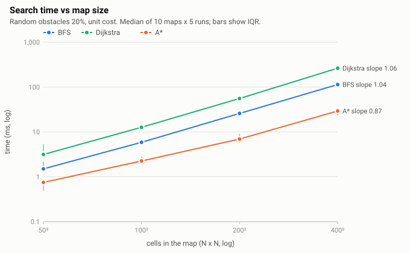

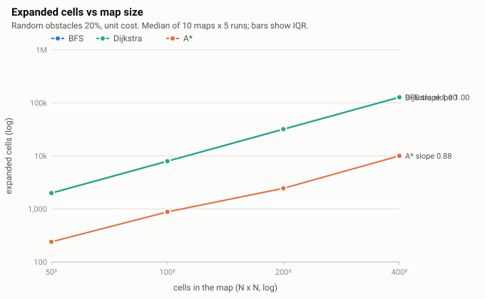

| algorithm | slope of time | slope of expanded |
| --- | ---: | ---: |
| BFS | 1.04 | 1.00 |
| Dijkstra | 1.06 | 1.00 |
| A* | 0.87 | 0.88 |

| condition | algorithm | time ms, median [IQR] | expanded | of reachable | stale | max frontier | cost / optimal | us per cell |
| --- | --- | ---: | ---: | ---: | ---: | ---: | ---: | ---: |
| random 20%, 50x50 | BFS | 1.50 [1.46-2.16] | 1,995 | 100% | 0 | 50 | 1.000 | 0.75 |
| random 20%, 50x50 | Dijkstra | 3.15 [3.06-5.34] | 1,995 | 100% | 0 | 50 | 1.000 | 1.58 |
| random 20%, 50x50 | A* | 0.75 [0.49-0.85] | 240 | 12% | 0 | 161 | 1.000 | 2.66 |
| random 20%, 100x100 | BFS | 5.88 [5.79-6.04] | 7,954 | 100% | 0 | 98 | 1.000 | 0.74 |
| random 20%, 100x100 | Dijkstra | 12.68 [12.53-14.74] | 7,954 | 100% | 0 | 98 | 1.000 | 1.59 |
| random 20%, 100x100 | A* | 2.25 [2.01-2.83] | 880 | 11% | 0 | 558 | 1.000 | 2.56 |
| random 20%, 200x200 | BFS | 25.83 [23.83-27.51] | 31,903 | 100% | 0 | 188 | 1.000 | 0.81 |
| random 20%, 200x200 | Dijkstra | 55.65 [53.46-61.35] | 31,903 | 100% | 0 | 188 | 1.000 | 1.74 |
| random 20%, 200x200 | A* | 6.95 [5.71-9.09] | 2,450 | 8% | 0 | 1,464 | 1.000 | 2.63 |
| random 20%, 400x400 | BFS | 113.98 [103.25-120.55] | 127,658 | 100% | 0 | 369 | 1.000 | 0.89 |
| random 20%, 400x400 | Dijkstra | 263.24 [247.11-281.16] | 127,658 | 100% | 0 | 369 | 1.000 | 2.06 |
| random 20%, 400x400 | A* | 29.32 [23.48-33.09] | 10,025 | 8% | 0 | 5,716 | 1.000 | 2.81 |

## B. Obstacle ratio

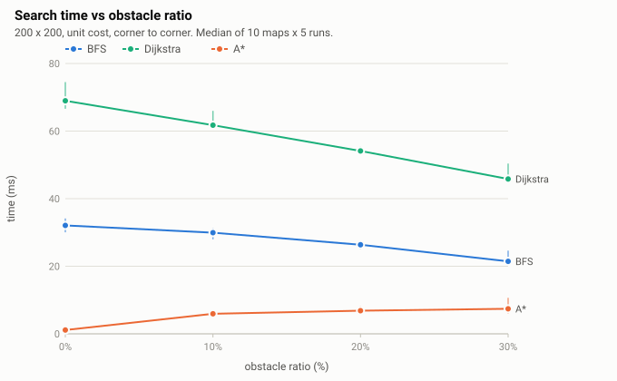

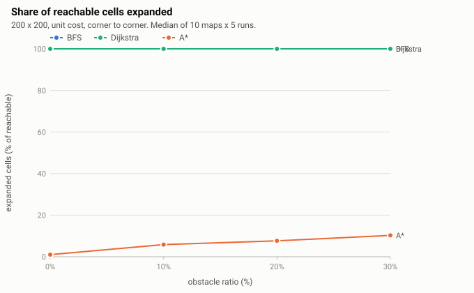

| condition | algorithm | time ms, median [IQR] | expanded | of reachable | stale | max frontier | cost / optimal | us per cell |
| --- | --- | ---: | ---: | ---: | ---: | ---: | ---: | ---: |
| random 0% | BFS | 32.07 [30.05-34.14] | 40,000 | 100% | 0 | 200 | 1.000 | 0.80 |
| random 0% | Dijkstra | 68.97 [66.61-74.51] | 40,000 | 100% | 0 | 200 | 1.000 | 1.72 |
| random 0% | A* | 1.14 [1.12-1.15] | 399 | 1% | 0 | 397 | 1.000 | 2.85 |
| random 10% | BFS | 29.95 [27.97-31.27] | 35,998 | 100% | 0 | 200 | 1.000 | 0.83 |
| random 10% | Dijkstra | 61.75 [60.55-65.98] | 35,998 | 100% | 0 | 200 | 1.000 | 1.72 |
| random 10% | A* | 5.93 [5.36-7.05] | 2,106 | 6% | 0 | 1,676 | 1.000 | 2.81 |
| random 20% | BFS | 26.37 [24.96-27.02] | 31,903 | 100% | 0 | 188 | 1.000 | 0.83 |
| random 20% | Dijkstra | 54.11 [52.98-55.36] | 31,903 | 100% | 0 | 188 | 1.000 | 1.70 |
| random 20% | A* | 6.86 [5.73-8.16] | 2,450 | 8% | 0 | 1,464 | 1.000 | 2.65 |
| random 30% | BFS | 21.45 [20.56-24.63] | 27,430 | 100% | 0 | 174 | 1.000 | 0.78 |
| random 30% | Dijkstra | 45.83 [44.64-50.38] | 27,430 | 100% | 0 | 174 | 1.000 | 1.67 |
| random 30% | A* | 7.41 [6.00-10.67] | 2,834 | 10% | 4 | 1,178 | 1.000 | 2.49 |

## C. Map kind

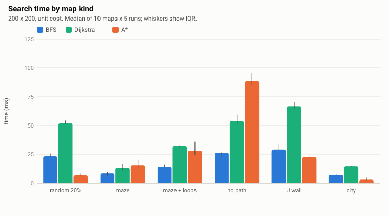

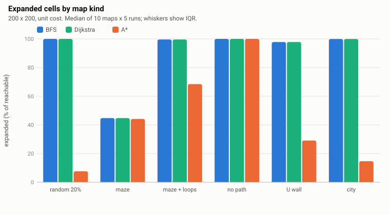

| condition | algorithm | time ms, median [IQR] | expanded | of reachable | stale | max frontier | cost / optimal | us per cell |
| --- | --- | ---: | ---: | ---: | ---: | ---: | ---: | ---: |
| random 20% | BFS | 23.23 [22.84-25.61] | 31,903 | 100% | 0 | 188 | 1.000 | 0.73 |
| random 20% | Dijkstra | 51.93 [51.13-54.34] | 31,903 | 100% | 0 | 188 | 1.000 | 1.62 |
| random 20% | A* | 6.69 [5.84-8.59] | 2,450 | 8% | 0 | 1,464 | 1.000 | 2.60 |
| maze | BFS | 8.43 [6.31-9.84] | 8,953 | 45% | 0 | 12 | 1.000 | 0.76 |
| maze | Dijkstra | 13.34 [10.80-16.62] | 8,953 | 45% | 0 | 12 | 1.000 | 1.34 |
| maze | A* | 15.54 [12.76-20.16] | 8,832 | 44% | 0 | 11 | 1.000 | 1.64 |
| maze + loops | BFS | 14.24 [13.88-16.21] | 20,862 | 100% | 0 | 106 | 1.000 | 0.68 |
| maze + loops | Dijkstra | 32.20 [30.25-32.93] | 20,862 | 100% | 0 | 106 | 1.000 | 1.54 |
| maze + loops | A* | 28.01 [24.16-35.85] | 14,346 | 68% | 572 | 227 | 1.000 | 1.90 |
| no path | BFS | 26.30 [22.90-26.70] | 31,900 | 100% | 0 | 188 | - | 0.83 |
| no path | Dijkstra | 53.79 [50.66-59.53] | 31,900 | 100% | 0 | 188 | - | 1.69 |
| no path | A* | 88.49 [84.64-95.70] | 31,900 | 100% | 12,330 | 10,513 | - | 2.77 |
| U wall | BFS | 29.10 [28.83-33.78] | 38,919 | 98% | 0 | 239 | 1.000 | 0.75 |
| U wall | Dijkstra | 66.37 [64.63-70.16] | 38,919 | 98% | 0 | 239 | 1.000 | 1.71 |
| U wall | A* | 22.44 [22.31-23.21] | 11,572 | 29% | 0 | 347 | 1.000 | 1.94 |
| city | BFS | 7.13 [6.69-7.68] | 10,232 | 100% | 0 | 74 | 1.000 | 0.69 |
| city | Dijkstra | 14.70 [14.47-15.16] | 10,232 | 100% | 0 | 74 | 1.000 | 1.43 |
| city | A* | 2.95 [2.28-4.83] | 1,506 | 15% | 0 | 156 | 1.000 | 1.91 |

## D. Cost model

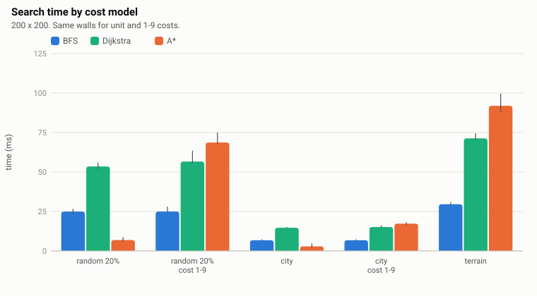

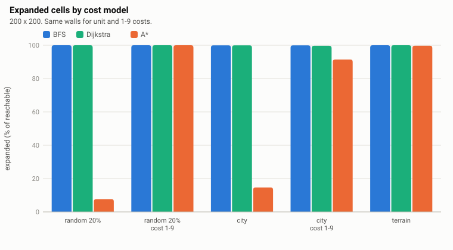

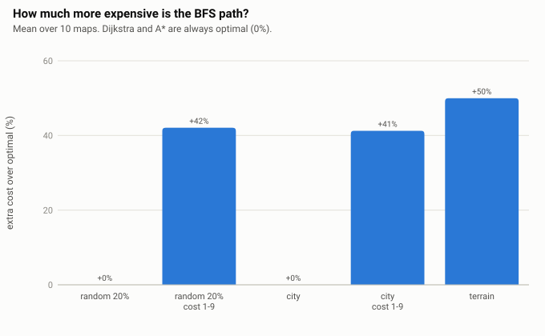

| condition | algorithm | time ms, median [IQR] | expanded | of reachable | stale | max frontier | cost / optimal | us per cell |
| --- | --- | ---: | ---: | ---: | ---: | ---: | ---: | ---: |
| random 20% | BFS | 24.90 [23.24-26.55] | 31,903 | 100% | 0 | 188 | 1.000 | 0.78 |
| random 20% | Dijkstra | 53.47 [51.86-55.90] | 31,903 | 100% | 0 | 188 | 1.000 | 1.68 |
| random 20% | A* | 6.88 [5.66-8.76] | 2,450 | 8% | 0 | 1,464 | 1.000 | 2.64 |
| random 20%, cost 1-9 | BFS | 24.97 [24.60-27.97] | 31,903 | 100% | 0 | 188 | 1.421 | 0.78 |
| random 20%, cost 1-9 | Dijkstra | 56.59 [55.60-63.46] | 31,898 | 100% | 0 | 272 | 1.000 | 1.77 |
| random 20%, cost 1-9 | A* | 68.64 [67.72-75.03] | 31,897 | 100% | 1,794 | 366 | 1.000 | 2.15 |
| city | BFS | 6.74 [6.66-7.32] | 10,232 | 100% | 0 | 74 | 1.000 | 0.66 |
| city | Dijkstra | 14.67 [14.39-15.14] | 10,232 | 100% | 0 | 74 | 1.000 | 1.44 |
| city | A* | 2.86 [1.67-4.76] | 1,506 | 15% | 0 | 156 | 1.000 | 1.88 |
| city, cost 1-9 | BFS | 6.75 [6.67-7.32] | 10,232 | 100% | 0 | 74 | 1.413 | 0.66 |
| city, cost 1-9 | Dijkstra | 15.15 [14.67-16.05] | 10,225 | 100% | 0 | 94 | 1.000 | 1.48 |
| city, cost 1-9 | A* | 17.28 [16.01-18.16] | 9,383 | 91% | 84 | 143 | 1.000 | 1.82 |
| terrain | BFS | 29.55 [29.24-30.94] | 40,000 | 100% | 0 | 200 | 1.500 | 0.74 |
| terrain | Dijkstra | 71.28 [70.45-74.50] | 40,000 | 100% | 0 | 330 | 1.000 | 1.78 |
| terrain | A* | 91.90 [87.77-99.58] | 39,888 | 100% | 2,994 | 494 | 1.000 | 2.30 |

## E. Fixed vs random endpoints

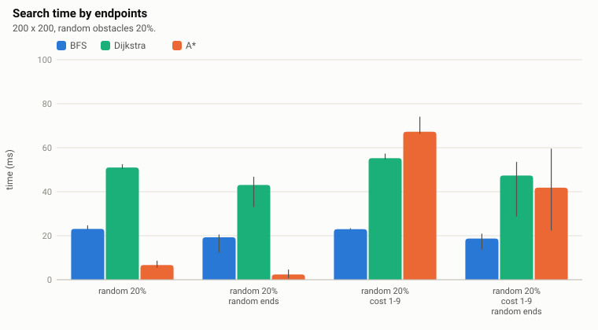

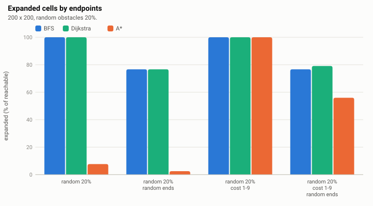

| condition | algorithm | time ms, median [IQR] | expanded | of reachable | stale | max frontier | cost / optimal | us per cell |
| --- | --- | ---: | ---: | ---: | ---: | ---: | ---: | ---: |
| random 20% | BFS | 23.10 [22.81-24.72] | 31,903 | 100% | 0 | 188 | 1.000 | 0.72 |
| random 20% | Dijkstra | 51.01 [50.35-52.49] | 31,903 | 100% | 0 | 188 | 1.000 | 1.59 |
| random 20% | A* | 6.67 [5.44-8.66] | 2,450 | 8% | 0 | 1,464 | 1.000 | 2.57 |
| random 20%, random ends | BFS | 19.29 [12.37-20.52] | 24,459 | 77% | 0 | 212 | 1.000 | 0.74 |
| random 20%, random ends | Dijkstra | 43.07 [33.02-46.79] | 24,459 | 77% | 0 | 212 | 1.000 | 1.66 |
| random 20%, random ends | A* | 2.38 [0.67-4.60] | 802 | 3% | 0 | 302 | 1.000 | 2.64 |
| random 20%, cost 1-9 | BFS | 22.98 [22.82-23.41] | 31,903 | 100% | 0 | 188 | 1.421 | 0.72 |
| random 20%, cost 1-9 | Dijkstra | 55.25 [54.60-57.34] | 31,898 | 100% | 0 | 272 | 1.000 | 1.73 |
| random 20%, cost 1-9 | A* | 67.27 [66.34-74.10] | 31,897 | 100% | 1,794 | 366 | 1.000 | 2.10 |
| random 20%, cost 1-9, random ends | BFS | 18.70 [13.65-20.92] | 24,459 | 77% | 0 | 212 | 1.286 | 0.74 |
| random 20%, cost 1-9, random ends | Dijkstra | 47.37 [28.76-53.53] | 25,232 | 79% | 0 | 284 | 1.000 | 1.80 |
| random 20%, cost 1-9, random ends | A* | 41.83 [22.39-59.56] | 17,848 | 56% | 1,092 | 336 | 1.000 | 2.22 |

## Time decomposition

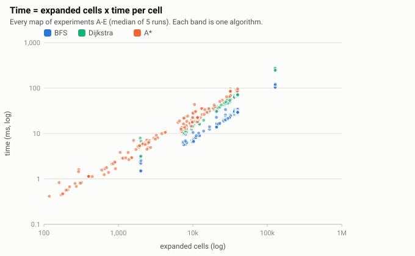

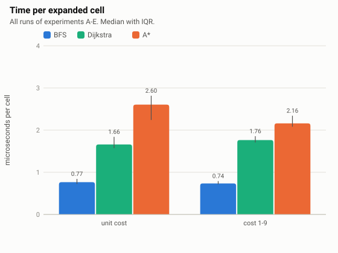

| algorithm | us per cell, unit cost | us per cell, cost 1-9 |
| --- | ---: | ---: |
| BFS | 0.77 | 0.74 |
| Dijkstra | 1.66 | 1.76 |
| A* | 2.60 | 2.16 |

## Heuristic accuracy

Accuracy 1 means the Manhattan distance equals the real remaining cost; with costs 1-9 it is about 1/5, and A* expands almost as much as Dijkstra.

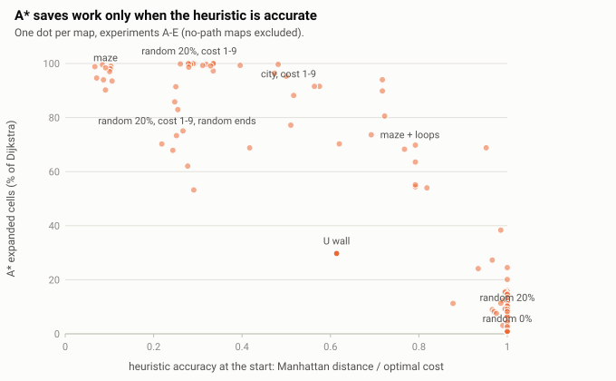

## Measurement noise

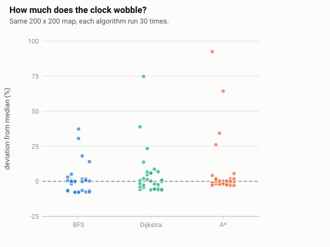

| algorithm | median ms | IQR / median | min | max |
| --- | ---: | ---: | ---: | ---: |
| BFS | 24.67 | 8.7% | 22.74 | 33.88 |
| Dijkstra | 53.91 | 11.3% | 50.61 | 94.24 |
| A* | 5.05 | 3.7% | 4.91 | 9.73 |

## T. A* tie-breaking

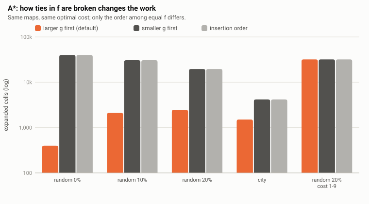

| condition | algorithm | time ms, median [IQR] | expanded | of reachable | stale | max frontier | cost / optimal | us per cell |
| --- | --- | ---: | ---: | ---: | ---: | ---: | ---: | ---: |
| random 0% | larger g first | 1.11 [1.11-1.13] | 399 | 1% | 0 | 397 | 1.000 | 2.79 |
| random 0% | smaller g first | 75.31 [74.15-83.46] | 40,000 | 100% | 0 | 200 | 1.000 | 1.88 |
| random 0% | insertion order | 74.25 [73.25-78.12] | 40,000 | 100% | 0 | 200 | 1.000 | 1.86 |
| random 10% | larger g first | 5.77 [5.25-8.32] | 2,106 | 6% | 0 | 1,676 | 1.000 | 2.73 |
| random 10% | smaller g first | 61.69 [58.92-66.22] | 30,604 | 85% | 0 | 742 | 1.000 | 1.98 |
| random 10% | insertion order | 60.74 [58.81-68.86] | 30,604 | 85% | 0 | 742 | 1.000 | 1.96 |
| random 20% | larger g first | 6.61 [5.61-8.60] | 2,450 | 8% | 0 | 1,464 | 1.000 | 2.58 |
| random 20% | smaller g first | 39.74 [37.36-45.15] | 19,572 | 61% | 0 | 1,420 | 1.000 | 2.01 |
| random 20% | insertion order | 38.93 [36.26-44.71] | 19,572 | 61% | 0 | 1,420 | 1.000 | 1.97 |
| city | larger g first | 2.84 [1.67-5.21] | 1,506 | 15% | 0 | 156 | 1.000 | 1.88 |
| city | smaller g first | 7.28 [5.95-11.20] | 4,176 | 41% | 0 | 188 | 1.000 | 1.71 |
| city | insertion order | 7.31 [5.81-11.36] | 4,176 | 41% | 0 | 188 | 1.000 | 1.70 |
| random 20%, cost 1-9 | larger g first | 67.50 [66.52-73.57] | 31,897 | 100% | 1,794 | 366 | 1.000 | 2.12 |
| random 20%, cost 1-9 | smaller g first | 64.70 [63.66-68.85] | 31,898 | 100% | 868 | 350 | 1.000 | 2.02 |
| random 20%, cost 1-9 | insertion order | 63.75 [63.07-66.32] | 31,898 | 100% | 1,230 | 352 | 1.000 | 2.00 |

## W. Weighted A*

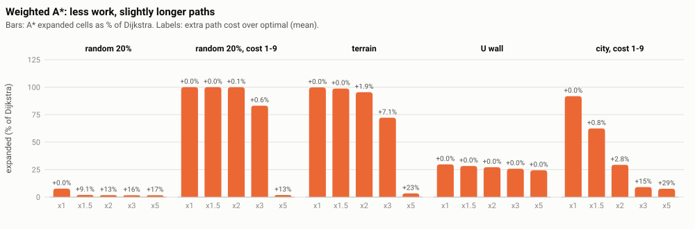

| condition | algorithm | time ms, median [IQR] | expanded | of reachable | stale | max frontier | cost / optimal | us per cell |
| --- | --- | ---: | ---: | ---: | ---: | ---: | ---: | ---: |
| random 20% | dijkstra | 52.39 [51.12-58.33] | 31,903 | 100% | 0 | 188 | 1.000 | 1.64 |
| random 20% | A* x1 | 6.47 [5.34-8.02] | 2,450 | 8% | 0 | 1,464 | 1.000 | 2.51 |
| random 20% | A* x1.5 | 1.79 [1.59-1.98] | 634 | 2% | 24 | 436 | 1.091 | 2.68 |
| random 20% | A* x2 | 1.56 [1.47-1.68] | 567 | 2% | 10 | 432 | 1.127 | 2.64 |
| random 20% | A* x3 | 1.45 [1.40-1.54] | 545 | 2% | 0 | 434 | 1.156 | 2.64 |
| random 20% | A* x5 | 1.43 [1.37-1.51] | 534 | 2% | 0 | 436 | 1.165 | 2.64 |
| random 20%, cost 1-9 | dijkstra | 55.10 [54.34-58.73] | 31,898 | 100% | 0 | 272 | 1.000 | 1.73 |
| random 20%, cost 1-9 | A* x1 | 65.60 [64.80-67.11] | 31,897 | 100% | 1,794 | 366 | 1.000 | 2.06 |
| random 20%, cost 1-9 | A* x1.5 | 69.74 [68.20-74.91] | 31,893 | 100% | 2,700 | 432 | 1.000 | 2.18 |
| random 20%, cost 1-9 | A* x2 | 71.39 [69.96-79.17] | 31,886 | 100% | 3,790 | 545 | 1.001 | 2.24 |
| random 20%, cost 1-9 | A* x3 | 66.02 [63.03-75.24] | 26,521 | 83% | 4,758 | 1,039 | 1.006 | 2.43 |
| random 20%, cost 1-9 | A* x5 | 1.65 [1.54-1.84] | 600 | 2% | 7 | 469 | 1.132 | 2.68 |
| terrain | dijkstra | 71.93 [70.72-79.15] | 40,000 | 100% | 0 | 330 | 1.000 | 1.80 |
| terrain | A* x1 | 85.20 [83.64-90.16] | 39,888 | 100% | 2,994 | 494 | 1.000 | 2.14 |
| terrain | A* x1.5 | 92.36 [87.91-102.99] | 39,492 | 99% | 5,029 | 593 | 1.000 | 2.35 |
| terrain | A* x2 | 93.23 [88.49-106.07] | 38,158 | 95% | 7,335 | 882 | 1.019 | 2.42 |
| terrain | A* x3 | 85.88 [70.77-92.72] | 28,876 | 72% | 9,828 | 1,728 | 1.071 | 2.70 |
| terrain | A* x5 | 4.78 [1.70-16.26] | 1,336 | 3% | 241 | 1,186 | 1.234 | 2.95 |
| U wall | dijkstra | 65.35 [64.85-70.20] | 38,919 | 98% | 0 | 239 | 1.000 | 1.68 |
| U wall | A* x1 | 21.33 [21.15-21.77] | 11,572 | 29% | 0 | 347 | 1.000 | 1.84 |
| U wall | A* x1.5 | 22.00 [21.80-24.03] | 11,012 | 28% | 0 | 347 | 1.000 | 2.00 |
| U wall | A* x2 | 20.78 [20.59-22.14] | 10,558 | 27% | 0 | 347 | 1.000 | 1.97 |
| U wall | A* x3 | 19.82 [19.62-20.28] | 10,052 | 25% | 0 | 347 | 1.000 | 1.97 |
| U wall | A* x5 | 18.82 [18.66-19.06] | 9,518 | 24% | 0 | 347 | 1.000 | 1.98 |
| city, cost 1-9 | dijkstra | 15.14 [14.84-19.36] | 10,225 | 100% | 0 | 94 | 1.000 | 1.48 |
| city, cost 1-9 | A* x1 | 16.86 [16.09-18.48] | 9,383 | 91% | 84 | 143 | 1.000 | 1.77 |
| city, cost 1-9 | A* x1.5 | 12.90 [10.46-16.10] | 6,381 | 62% | 66 | 136 | 1.008 | 1.84 |
| city, cost 1-9 | A* x2 | 6.17 [3.82-11.75] | 3,001 | 29% | 39 | 128 | 1.028 | 1.79 |
| city, cost 1-9 | A* x3 | 1.72 [1.62-2.70] | 929 | 9% | 8 | 106 | 1.148 | 1.81 |
| city, cost 1-9 | A* x5 | 1.57 [1.31-1.78] | 776 | 8% | 4 | 97 | 1.295 | 1.82 |

## H. heapq vs plain-Python heap

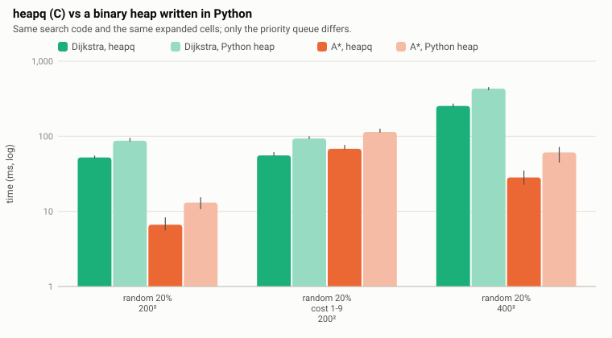

| condition | algorithm | heapq ms | Python heap ms | slower by |
| --- | ---: | ---: | ---: | ---: |
| random 20% 200² | Dijkstra | 52.17 | 87.14 | 1.67x |
| random 20% 200² | A* | 6.65 | 13.09 | 1.97x |
| random 20%, cost 1-9 200² | Dijkstra | 55.64 | 93.36 | 1.68x |
| random 20%, cost 1-9 200² | A* | 68.03 | 114.07 | 1.68x |
| random 20% 400² | Dijkstra | 252.92 | 430.99 | 1.70x |
| random 20% 400² | A* | 28.28 | 60.96 | 2.16x |

## BI. Bidirectional Dijkstra

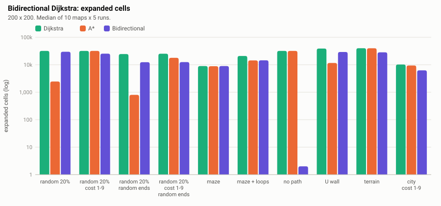

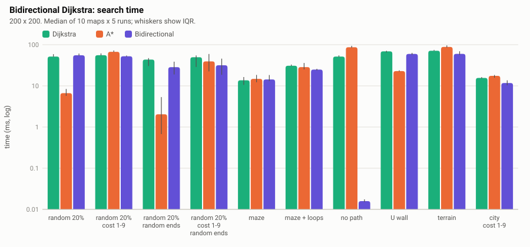

| condition | algorithm | time ms, median [IQR] | expanded | of reachable | stale | max frontier | cost / optimal | us per cell |
| --- | --- | ---: | ---: | ---: | ---: | ---: | ---: | ---: |
| random 20% | Dijkstra | 51.46 [50.79-58.79] | 31,903 | 100% | 0 | 188 | 1.000 | 1.61 |
| random 20% | A* | 6.64 [5.72-8.39] | 2,450 | 8% | 0 | 1,464 | 1.000 | 2.58 |
| random 20% | Bidirectional | 55.32 [54.14-60.87] | 29,748 | 93% | 0 | 326 | 1.000 | 1.86 |
| random 20%, cost 1-9 | Dijkstra | 55.58 [54.38-61.55] | 31,898 | 100% | 0 | 272 | 1.000 | 1.74 |
| random 20%, cost 1-9 | A* | 67.11 [65.97-72.42] | 31,897 | 100% | 1,794 | 366 | 1.000 | 2.11 |
| random 20%, cost 1-9 | Bidirectional | 52.26 [51.29-54.59] | 25,286 | 79% | 2,011 | 429 | 1.000 | 2.05 |
| random 20%, random ends | Dijkstra | 43.53 [30.32-47.19] | 24,459 | 77% | 0 | 212 | 1.000 | 1.69 |
| random 20%, random ends | A* | 2.04 [0.67-5.34] | 802 | 3% | 0 | 302 | 1.000 | 2.85 |
| random 20%, random ends | Bidirectional | 28.45 [18.93-38.62] | 12,408 | 39% | 0 | 329 | 1.000 | 1.98 |
| random 20%, cost 1-9, random ends | Dijkstra | 49.70 [28.71-54.70] | 25,232 | 79% | 0 | 284 | 1.000 | 1.80 |
| random 20%, cost 1-9, random ends | A* | 39.25 [22.50-59.52] | 17,848 | 56% | 1,092 | 336 | 1.000 | 2.21 |
| random 20%, cost 1-9, random ends | Bidirectional | 31.61 [18.54-45.84] | 12,486 | 39% | 1,564 | 428 | 1.000 | 2.12 |
| maze | Dijkstra | 13.68 [10.57-16.38] | 8,953 | 45% | 0 | 12 | 1.000 | 1.32 |
| maze | A* | 14.80 [12.27-18.42] | 8,832 | 44% | 0 | 11 | 1.000 | 1.56 |
| maze | Bidirectional | 14.32 [13.09-18.34] | 8,958 | 45% | 0 | 20 | 1.000 | 1.57 |
| maze + loops | Dijkstra | 30.83 [30.49-32.92] | 20,862 | 100% | 0 | 106 | 1.000 | 1.48 |
| maze + loops | A* | 28.57 [25.10-35.99] | 14,346 | 68% | 572 | 227 | 1.000 | 1.89 |
| maze + loops | Bidirectional | 24.89 [23.79-25.98] | 14,500 | 69% | 0 | 146 | 1.000 | 1.66 |
| no path | Dijkstra | 51.38 [50.55-54.88] | 31,900 | 100% | 0 | 188 | - | 1.61 |
| no path | A* | 86.68 [84.03-93.91] | 31,900 | 100% | 12,330 | 10,513 | - | 2.72 |
| no path | Bidirectional | 0.02 [0.02-0.02] | 2 | 0% | 0 | 3 | - | 7.55 |
| U wall | Dijkstra | 68.90 [64.85-71.02] | 38,919 | 98% | 0 | 239 | 1.000 | 1.77 |
| U wall | A* | 22.83 [22.34-23.87] | 11,572 | 29% | 0 | 347 | 1.000 | 1.97 |
| U wall | Bidirectional | 59.68 [56.64-63.27] | 29,129 | 73% | 0 | 357 | 1.000 | 2.05 |
| terrain | Dijkstra | 71.36 [70.46-74.66] | 40,000 | 100% | 0 | 330 | 1.000 | 1.79 |
| terrain | A* | 88.29 [85.70-96.13] | 39,888 | 100% | 2,994 | 494 | 1.000 | 2.21 |
| terrain | Bidirectional | 59.92 [56.69-69.28] | 28,242 | 71% | 335 | 484 | 1.000 | 2.07 |
| city, cost 1-9 | Dijkstra | 15.59 [15.01-16.32] | 10,225 | 100% | 0 | 94 | 1.000 | 1.55 |
| city, cost 1-9 | A* | 17.52 [15.74-18.39] | 9,383 | 91% | 84 | 143 | 1.000 | 1.85 |
| city, cost 1-9 | Bidirectional | 11.72 [10.29-13.63] | 6,263 | 61% | 10 | 124 | 1.000 | 1.72 |

## Code size

Lines of code without blank lines, comments and docstrings.

| algorithm | code | lines |
| --- | --- | ---: |
| BFS | `bfs` | 23 |
| Dijkstra | `best_first` + `dijkstra` | 60 |
| A* | `best_first` + `astar` (+ `manhattan`) | 64 |
| Bidirectional Dijkstra | `bidirectional_dijkstra` | 64 |
| shared by all | `Grid.neighbors`, `reconstruct_path`, `_trivial` | 35 |

Dijkstra and A* share `best_first`, which also carries the options used in the extra experiments (tie-break, weight, heap choice), so their counts include those lines.
