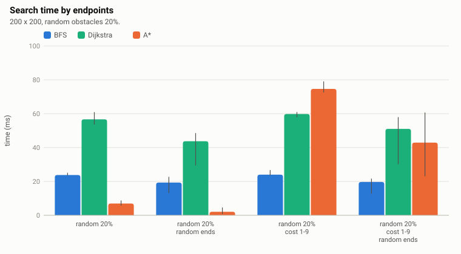
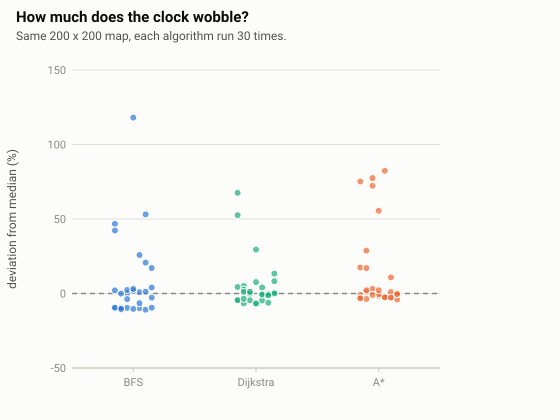
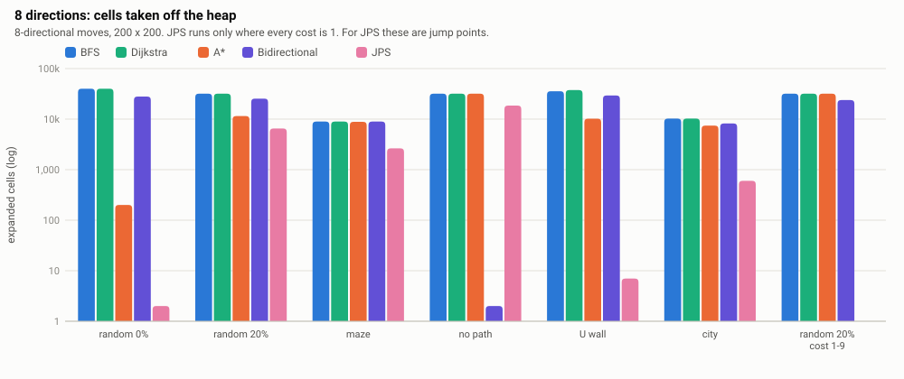
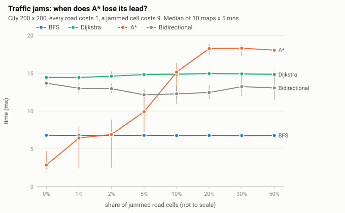

# Experiment results

Generated by `make analyze` from the raw data in `results/`. Times are medians over 10 maps x 5 runs with the interquartile range (IQR) in brackets.

Measured on GitHub Codespaces: AMD EPYC 7763 64-Core Processor, 2 CPUs, Python 3.13.5, commit `98ce166`.

## A. Map size

Slope on the log-log chart: 1 means time grows in proportion to the number of cells.

| algorithm | slope of time | slope of expanded |
| --- | ---: | ---: |
| BFS | 1.01 | 1.00 |
| Dijkstra | 1.06 | 1.00 |
| A* | 0.86 | 0.88 |

| condition | algorithm | time ms, median [IQR] | expanded | of reachable | stale | max frontier | cost / optimal | us per cell |
| --- | --- | ---: | ---: | ---: | ---: | ---: | ---: | ---: |
| random 20%, 50x50 | BFS | 1.48 [1.45-1.74] | 1,995 | 100% | 0 | 50 | 1.000 | 0.74 |
| random 20%, 50x50 | Dijkstra | 3.09 [2.98-3.25] | 1,995 | 100% | 0 | 50 | 1.000 | 1.56 |
| random 20%, 50x50 | A* | 0.75 [0.50-0.83] | 240 | 12% | 0 | 161 | 1.000 | 2.71 |
| random 20%, 100x100 | BFS | 7.79 [6.08-10.37] | 7,954 | 100% | 0 | 98 | 1.000 | 0.98 |
| random 20%, 100x100 | Dijkstra | 14.18 [12.95-24.01] | 7,954 | 100% | 0 | 98 | 1.000 | 1.79 |
| random 20%, 100x100 | A* | 2.94 [2.38-3.86] | 880 | 11% | 0 | 558 | 1.000 | 2.73 |
| random 20%, 200x200 | BFS | 25.62 [24.29-27.48] | 31,903 | 100% | 0 | 188 | 1.000 | 0.80 |
| random 20%, 200x200 | Dijkstra | 59.26 [55.84-63.50] | 31,903 | 100% | 0 | 188 | 1.000 | 1.86 |
| random 20%, 200x200 | A* | 6.98 [5.84-8.97] | 2,450 | 8% | 0 | 1,464 | 1.000 | 2.70 |
| random 20%, 400x400 | BFS | 106.50 [105.23-110.49] | 127,658 | 100% | 0 | 369 | 1.000 | 0.83 |
| random 20%, 400x400 | Dijkstra | 263.10 [254.34-289.19] | 127,658 | 100% | 0 | 369 | 1.000 | 2.06 |
| random 20%, 400x400 | A* | 30.25 [22.31-37.44] | 10,025 | 8% | 0 | 5,716 | 1.000 | 2.95 |

## B. Obstacle ratio

| condition | algorithm | time ms, median [IQR] | expanded | of reachable | stale | max frontier | cost / optimal | us per cell |
| --- | --- | ---: | ---: | ---: | ---: | ---: | ---: | ---: |
| random 0% | BFS | 31.01 [30.01-33.53] | 40,000 | 100% | 0 | 200 | 1.000 | 0.78 |
| random 0% | Dijkstra | 71.28 [69.01-88.21] | 40,000 | 100% | 0 | 200 | 1.000 | 1.78 |
| random 0% | A* | 1.18 [1.16-1.21] | 399 | 1% | 0 | 397 | 1.000 | 2.95 |
| random 10% | BFS | 27.00 [26.63-27.89] | 35,998 | 100% | 0 | 200 | 1.000 | 0.75 |
| random 10% | Dijkstra | 64.22 [61.85-69.17] | 35,998 | 100% | 0 | 200 | 1.000 | 1.78 |
| random 10% | A* | 6.13 [5.52-6.97] | 2,106 | 6% | 0 | 1,676 | 1.000 | 2.88 |
| random 20% | BFS | 24.27 [23.79-26.91] | 31,903 | 100% | 0 | 188 | 1.000 | 0.76 |
| random 20% | Dijkstra | 55.51 [53.95-57.87] | 31,903 | 100% | 0 | 188 | 1.000 | 1.74 |
| random 20% | A* | 6.96 [5.93-8.66] | 2,450 | 8% | 0 | 1,464 | 1.000 | 2.71 |
| random 30% | BFS | 20.54 [20.22-22.93] | 27,430 | 100% | 0 | 174 | 1.000 | 0.75 |
| random 30% | Dijkstra | 47.78 [45.04-50.25] | 27,430 | 100% | 0 | 174 | 1.000 | 1.74 |
| random 30% | A* | 7.76 [6.23-10.67] | 2,834 | 10% | 4 | 1,178 | 1.000 | 2.53 |

## C. Map kind

| condition | algorithm | time ms, median [IQR] | expanded | of reachable | stale | max frontier | cost / optimal | us per cell |
| --- | --- | ---: | ---: | ---: | ---: | ---: | ---: | ---: |
| random 20% | BFS | 23.77 [23.60-26.65] | 31,903 | 100% | 0 | 188 | 1.000 | 0.74 |
| random 20% | Dijkstra | 54.48 [53.36-58.66] | 31,903 | 100% | 0 | 188 | 1.000 | 1.71 |
| random 20% | A* | 7.12 [5.86-8.52] | 2,450 | 8% | 0 | 1,464 | 1.000 | 2.71 |
| maze | BFS | 7.54 [6.58-9.73] | 8,953 | 45% | 0 | 12 | 1.000 | 0.80 |
| maze | Dijkstra | 14.84 [10.80-17.31] | 8,953 | 45% | 0 | 12 | 1.000 | 1.34 |
| maze | A* | 16.83 [13.57-19.64] | 8,832 | 44% | 0 | 11 | 1.000 | 1.66 |
| maze + loops | BFS | 14.54 [14.23-15.44] | 20,862 | 100% | 0 | 106 | 1.000 | 0.70 |
| maze + loops | Dijkstra | 33.96 [31.65-36.20] | 20,862 | 100% | 0 | 106 | 1.000 | 1.62 |
| maze + loops | A* | 29.94 [26.41-40.36] | 14,346 | 68% | 572 | 227 | 1.000 | 2.19 |
| no path | BFS | 24.00 [23.50-25.91] | 31,900 | 100% | 0 | 188 | - | 0.75 |
| no path | Dijkstra | 55.82 [53.22-57.24] | 31,900 | 100% | 0 | 188 | - | 1.75 |
| no path | A* | 95.02 [91.08-98.66] | 31,900 | 100% | 12,330 | 10,513 | - | 2.98 |
| U wall | BFS | 33.17 [30.27-38.83] | 38,919 | 98% | 0 | 239 | 1.000 | 0.85 |
| U wall | Dijkstra | 72.20 [70.03-83.62] | 38,919 | 98% | 0 | 239 | 1.000 | 1.86 |
| U wall | A* | 24.12 [23.38-30.54] | 11,572 | 29% | 0 | 347 | 1.000 | 2.08 |
| city | BFS | 6.83 [6.73-7.18] | 10,232 | 100% | 0 | 74 | 1.000 | 0.67 |
| city | Dijkstra | 14.71 [14.41-17.39] | 10,232 | 100% | 0 | 74 | 1.000 | 1.44 |
| city | A* | 2.94 [2.35-4.86] | 1,506 | 15% | 0 | 156 | 1.000 | 1.93 |

## D. Cost model

| condition | algorithm | time ms, median [IQR] | expanded | of reachable | stale | max frontier | cost / optimal | us per cell |
| --- | --- | ---: | ---: | ---: | ---: | ---: | ---: | ---: |
| random 20% | BFS | 25.59 [23.74-29.10] | 31,903 | 100% | 0 | 188 | 1.000 | 0.80 |
| random 20% | Dijkstra | 61.64 [55.89-68.00] | 31,903 | 100% | 0 | 188 | 1.000 | 1.93 |
| random 20% | A* | 7.77 [5.92-10.18] | 2,450 | 8% | 0 | 1,464 | 1.000 | 2.79 |
| random 20%, cost 1-9 | BFS | 24.06 [23.51-29.61] | 31,903 | 100% | 0 | 188 | 1.421 | 0.75 |
| random 20%, cost 1-9 | Dijkstra | 61.17 [58.21-66.60] | 31,898 | 100% | 0 | 272 | 1.000 | 1.92 |
| random 20%, cost 1-9 | A* | 75.60 [72.09-84.33] | 31,897 | 100% | 1,794 | 366 | 1.000 | 2.36 |
| city | BFS | 6.78 [6.73-6.92] | 10,232 | 100% | 0 | 74 | 1.000 | 0.66 |
| city | Dijkstra | 14.79 [14.42-15.44] | 10,232 | 100% | 0 | 74 | 1.000 | 1.44 |
| city | A* | 2.91 [1.75-4.82] | 1,506 | 15% | 0 | 156 | 1.000 | 1.93 |
| city, cost 1-9 | BFS | 6.89 [6.76-8.52] | 10,232 | 100% | 0 | 74 | 1.413 | 0.67 |
| city, cost 1-9 | Dijkstra | 15.65 [15.15-17.43] | 10,225 | 100% | 0 | 94 | 1.000 | 1.53 |
| city, cost 1-9 | A* | 18.01 [15.21-20.48] | 9,383 | 91% | 84 | 143 | 1.000 | 1.91 |
| terrain | BFS | 30.70 [30.23-33.90] | 40,000 | 100% | 0 | 200 | 1.500 | 0.77 |
| terrain | Dijkstra | 77.17 [75.79-81.14] | 40,000 | 100% | 0 | 330 | 1.000 | 1.94 |
| terrain | A* | 95.16 [93.19-101.69] | 39,888 | 100% | 2,994 | 494 | 1.000 | 2.40 |

## E. Fixed vs random endpoints

| condition | algorithm | time ms, median [IQR] | expanded | of reachable | stale | max frontier | cost / optimal | us per cell |
| --- | --- | ---: | ---: | ---: | ---: | ---: | ---: | ---: |
| random 20% | BFS | 23.79 [23.55-25.11] | 31,903 | 100% | 0 | 188 | 1.000 | 0.75 |
| random 20% | Dijkstra | 56.69 [53.62-60.93] | 31,903 | 100% | 0 | 188 | 1.000 | 1.78 |
| random 20% | A* | 6.97 [5.75-8.76] | 2,450 | 8% | 0 | 1,464 | 1.000 | 2.71 |
| random 20%, random ends | BFS | 19.33 [13.19-22.70] | 24,459 | 77% | 0 | 212 | 1.000 | 0.76 |
| random 20%, random ends | Dijkstra | 43.74 [29.38-48.53] | 24,459 | 77% | 0 | 212 | 1.000 | 1.72 |
| random 20%, random ends | A* | 2.06 [0.72-4.60] | 802 | 3% | 0 | 302 | 1.000 | 2.66 |
| random 20%, cost 1-9 | BFS | 23.98 [23.54-26.72] | 31,903 | 100% | 0 | 188 | 1.421 | 0.75 |
| random 20%, cost 1-9 | Dijkstra | 59.82 [57.92-60.98] | 31,898 | 100% | 0 | 272 | 1.000 | 1.87 |
| random 20%, cost 1-9 | A* | 74.64 [72.57-79.06] | 31,897 | 100% | 1,794 | 366 | 1.000 | 2.34 |
| random 20%, cost 1-9, random ends | BFS | 19.69 [12.72-21.63] | 24,459 | 77% | 0 | 212 | 1.286 | 0.76 |
| random 20%, cost 1-9, random ends | Dijkstra | 51.02 [30.16-57.95] | 25,232 | 79% | 0 | 284 | 1.000 | 1.93 |
| random 20%, cost 1-9, random ends | A* | 42.92 [23.06-60.69] | 17,848 | 56% | 1,092 | 336 | 1.000 | 2.35 |

## Time decomposition

| algorithm | us per cell, unit cost | us per cell, cost 1-9 |
| --- | ---: | ---: |
| BFS | 0.76 | 0.76 |
| Dijkstra | 1.75 | 1.89 |
| A* | 2.71 | 2.34 |

## Heuristic accuracy

Accuracy 1 means the Manhattan distance equals the real remaining cost; with costs 1-9 it is about 1/5, and A* expands almost as much as Dijkstra.

## Measurement noise

| algorithm | median ms | IQR / median | min | max |
| --- | ---: | ---: | ---: | ---: |
| BFS | 23.98 | 14.1% | 23.11 | 43.58 |
| Dijkstra | 57.53 | 8.0% | 53.31 | 94.13 |
| A* | 5.30 | 10.5% | 5.10 | 10.20 |

## T. A* tie-breaking

| condition | algorithm | time ms, median [IQR] | expanded | of reachable | stale | max frontier | cost / optimal | us per cell |
| --- | --- | ---: | ---: | ---: | ---: | ---: | ---: | ---: |
| random 0% | larger g first | 1.17 [1.16-1.20] | 399 | 1% | 0 | 397 | 1.000 | 2.94 |
| random 0% | smaller g first | 81.20 [79.07-86.60] | 40,000 | 100% | 0 | 200 | 1.000 | 2.03 |
| random 0% | insertion order | 80.77 [78.38-88.42] | 40,000 | 100% | 0 | 200 | 1.000 | 2.02 |
| random 10% | larger g first | 6.03 [5.55-7.12] | 2,106 | 6% | 0 | 1,676 | 1.000 | 2.85 |
| random 10% | smaller g first | 67.50 [64.36-75.94] | 30,604 | 85% | 0 | 742 | 1.000 | 2.20 |
| random 10% | insertion order | 64.07 [63.04-66.56] | 30,604 | 85% | 0 | 742 | 1.000 | 2.12 |
| random 20% | larger g first | 6.95 [5.63-8.71] | 2,450 | 8% | 0 | 1,464 | 1.000 | 2.69 |
| random 20% | smaller g first | 43.92 [39.86-48.40] | 19,572 | 61% | 0 | 1,420 | 1.000 | 2.19 |
| random 20% | insertion order | 42.74 [39.29-47.25] | 19,572 | 61% | 0 | 1,420 | 1.000 | 2.11 |
| city | larger g first | 2.97 [1.74-4.90] | 1,506 | 15% | 0 | 156 | 1.000 | 1.94 |
| city | smaller g first | 7.52 [6.18-11.36] | 4,176 | 41% | 0 | 188 | 1.000 | 1.77 |
| city | insertion order | 7.35 [6.16-10.73] | 4,176 | 41% | 0 | 188 | 1.000 | 1.75 |
| random 20%, cost 1-9 | larger g first | 74.30 [71.55-78.13] | 31,897 | 100% | 1,794 | 366 | 1.000 | 2.33 |
| random 20%, cost 1-9 | smaller g first | 70.48 [68.21-79.58] | 31,898 | 100% | 868 | 350 | 1.000 | 2.20 |
| random 20%, cost 1-9 | insertion order | 70.45 [67.75-74.09] | 31,898 | 100% | 1,230 | 352 | 1.000 | 2.21 |

## W. Weighted A*

| condition | algorithm | time ms, median [IQR] | expanded | of reachable | stale | max frontier | cost / optimal | us per cell |
| --- | --- | ---: | ---: | ---: | ---: | ---: | ---: | ---: |
| random 20% | dijkstra | 53.82 [53.17-55.99] | 31,903 | 100% | 0 | 188 | 1.000 | 1.68 |
| random 20% | A* x1 | 6.37 [5.50-7.93] | 2,450 | 8% | 0 | 1,464 | 1.000 | 2.61 |
| random 20% | A* x1.5 | 1.73 [1.62-1.91] | 634 | 2% | 24 | 436 | 1.091 | 2.75 |
| random 20% | A* x2 | 1.56 [1.51-1.70] | 567 | 2% | 10 | 432 | 1.127 | 2.72 |
| random 20% | A* x3 | 1.50 [1.43-1.56] | 545 | 2% | 0 | 434 | 1.156 | 2.72 |
| random 20% | A* x5 | 1.44 [1.39-1.56] | 534 | 2% | 0 | 436 | 1.165 | 2.70 |
| random 20%, cost 1-9 | dijkstra | 59.93 [57.85-65.70] | 31,898 | 100% | 0 | 272 | 1.000 | 1.88 |
| random 20%, cost 1-9 | A* x1 | 73.45 [70.77-75.06] | 31,897 | 100% | 1,794 | 366 | 1.000 | 2.30 |
| random 20%, cost 1-9 | A* x1.5 | 75.61 [73.53-80.21] | 31,893 | 100% | 2,700 | 432 | 1.000 | 2.37 |
| random 20%, cost 1-9 | A* x2 | 78.76 [76.04-83.58] | 31,886 | 100% | 3,790 | 545 | 1.001 | 2.47 |
| random 20%, cost 1-9 | A* x3 | 72.22 [68.37-84.28] | 26,521 | 83% | 4,758 | 1,039 | 1.006 | 2.67 |
| random 20%, cost 1-9 | A* x5 | 1.71 [1.60-1.92] | 600 | 2% | 7 | 469 | 1.132 | 2.81 |
| terrain | dijkstra | 77.39 [74.56-85.34] | 40,000 | 100% | 0 | 330 | 1.000 | 1.93 |
| terrain | A* x1 | 92.58 [90.90-96.76] | 39,888 | 100% | 2,994 | 494 | 1.000 | 2.33 |
| terrain | A* x1.5 | 99.05 [94.40-106.05] | 39,492 | 99% | 5,029 | 593 | 1.000 | 2.52 |
| terrain | A* x2 | 101.43 [95.29-114.48] | 38,158 | 95% | 7,335 | 882 | 1.019 | 2.64 |
| terrain | A* x3 | 92.86 [75.99-102.40] | 28,876 | 72% | 9,828 | 1,728 | 1.071 | 2.88 |
| terrain | A* x5 | 5.16 [1.70-14.93] | 1,336 | 3% | 241 | 1,186 | 1.234 | 3.07 |
| U wall | dijkstra | 73.10 [69.96-83.03] | 38,919 | 98% | 0 | 239 | 1.000 | 1.88 |
| U wall | A* x1 | 23.03 [22.20-25.87] | 11,572 | 29% | 0 | 347 | 1.000 | 1.99 |
| U wall | A* x1.5 | 25.61 [22.91-28.19] | 11,012 | 28% | 0 | 347 | 1.000 | 2.33 |
| U wall | A* x2 | 23.22 [21.42-26.58] | 10,558 | 27% | 0 | 347 | 1.000 | 2.20 |
| U wall | A* x3 | 21.86 [20.31-26.37] | 10,052 | 25% | 0 | 347 | 1.000 | 2.18 |
| U wall | A* x5 | 20.55 [19.51-25.88] | 9,518 | 24% | 0 | 347 | 1.000 | 2.16 |
| city, cost 1-9 | dijkstra | 15.53 [15.22-16.39] | 10,225 | 100% | 0 | 94 | 1.000 | 1.54 |
| city, cost 1-9 | A* x1 | 17.58 [16.80-19.26] | 9,383 | 91% | 84 | 143 | 1.000 | 1.85 |
| city, cost 1-9 | A* x1.5 | 13.84 [11.02-17.04] | 6,381 | 62% | 66 | 136 | 1.008 | 1.91 |
| city, cost 1-9 | A* x2 | 6.83 [3.95-11.41] | 3,001 | 29% | 39 | 128 | 1.028 | 1.87 |
| city, cost 1-9 | A* x3 | 2.12 [1.64-2.97] | 929 | 9% | 8 | 106 | 1.148 | 1.87 |
| city, cost 1-9 | A* x5 | 1.46 [1.34-1.97] | 776 | 8% | 4 | 97 | 1.295 | 1.86 |

## H. heapq vs plain-Python heap

| condition | algorithm | heapq ms | Python heap ms | slower by |
| --- | ---: | ---: | ---: | ---: |
| random 20% 200² | Dijkstra | 55.57 | 90.52 | 1.63x |
| random 20% 200² | A* | 6.92 | 13.25 | 1.91x |
| random 20%, cost 1-9 200² | Dijkstra | 60.25 | 96.89 | 1.61x |
| random 20%, cost 1-9 200² | A* | 73.72 | 121.77 | 1.65x |
| random 20% 400² | Dijkstra | 266.41 | 438.05 | 1.64x |
| random 20% 400² | A* | 29.72 | 64.98 | 2.19x |

## BI. Bidirectional Dijkstra

| condition | algorithm | time ms, median [IQR] | expanded | of reachable | stale | max frontier | cost / optimal | us per cell |
| --- | --- | ---: | ---: | ---: | ---: | ---: | ---: | ---: |
| random 20% | Dijkstra | 56.19 [53.77-58.75] | 31,903 | 100% | 0 | 188 | 1.000 | 1.76 |
| random 20% | A* | 7.00 [5.97-8.62] | 2,450 | 8% | 0 | 1,464 | 1.000 | 2.71 |
| random 20% | Bidirectional | 61.48 [59.63-64.91] | 29,748 | 93% | 0 | 326 | 1.000 | 2.07 |
| random 20%, cost 1-9 | Dijkstra | 63.18 [59.91-71.94] | 31,898 | 100% | 0 | 272 | 1.000 | 1.98 |
| random 20%, cost 1-9 | A* | 76.29 [72.00-85.97] | 31,897 | 100% | 1,794 | 366 | 1.000 | 2.39 |
| random 20%, cost 1-9 | Bidirectional | 59.83 [57.00-64.16] | 25,286 | 79% | 2,011 | 429 | 1.000 | 2.38 |
| random 20%, random ends | Dijkstra | 46.86 [34.70-55.17] | 24,459 | 77% | 0 | 212 | 1.000 | 1.88 |
| random 20%, random ends | A* | 2.89 [0.74-5.13] | 802 | 3% | 0 | 302 | 1.000 | 3.02 |
| random 20%, random ends | Bidirectional | 30.91 [22.12-42.93] | 12,408 | 39% | 0 | 329 | 1.000 | 2.26 |
| random 20%, cost 1-9, random ends | Dijkstra | 52.89 [30.68-59.06] | 25,232 | 79% | 0 | 284 | 1.000 | 1.98 |
| random 20%, cost 1-9, random ends | A* | 48.99 [24.96-67.00] | 17,848 | 56% | 1,092 | 336 | 1.000 | 2.47 |
| random 20%, cost 1-9, random ends | Bidirectional | 35.58 [20.15-51.73] | 12,486 | 39% | 1,564 | 428 | 1.000 | 2.35 |
| maze | Dijkstra | 15.82 [11.44-20.35] | 8,953 | 45% | 0 | 12 | 1.000 | 1.45 |
| maze | A* | 18.57 [14.08-25.21] | 8,832 | 44% | 0 | 11 | 1.000 | 1.91 |
| maze | Bidirectional | 18.02 [15.23-24.02] | 8,958 | 45% | 0 | 20 | 1.000 | 1.76 |
| maze + loops | Dijkstra | 35.15 [32.65-38.12] | 20,862 | 100% | 0 | 106 | 1.000 | 1.68 |
| maze + loops | A* | 33.07 [23.99-37.93] | 14,346 | 68% | 572 | 227 | 1.000 | 2.11 |
| maze + loops | Bidirectional | 27.87 [25.23-30.12] | 14,500 | 69% | 0 | 146 | 1.000 | 1.90 |
| no path | Dijkstra | 55.98 [53.28-61.64] | 31,900 | 100% | 0 | 188 | - | 1.75 |
| no path | A* | 100.32 [94.27-109.63] | 31,900 | 100% | 12,330 | 10,513 | - | 3.14 |
| no path | Bidirectional | 0.02 [0.02-0.02] | 2 | 0% | 0 | 3 | - | 9.95 |
| U wall | Dijkstra | 71.97 [69.95-85.72] | 38,919 | 98% | 0 | 239 | 1.000 | 1.85 |
| U wall | A* | 25.26 [23.64-28.89] | 11,572 | 29% | 0 | 347 | 1.000 | 2.18 |
| U wall | Bidirectional | 66.96 [65.18-72.76] | 29,129 | 73% | 0 | 357 | 1.000 | 2.30 |
| terrain | Dijkstra | 82.22 [76.66-89.73] | 40,000 | 100% | 0 | 330 | 1.000 | 2.07 |
| terrain | A* | 100.23 [96.30-108.72] | 39,888 | 100% | 2,994 | 494 | 1.000 | 2.54 |
| terrain | Bidirectional | 72.94 [66.20-81.07] | 28,242 | 71% | 335 | 484 | 1.000 | 2.41 |
| city, cost 1-9 | Dijkstra | 16.59 [15.52-19.45] | 10,225 | 100% | 0 | 94 | 1.000 | 1.61 |
| city, cost 1-9 | A* | 18.75 [16.94-21.77] | 9,383 | 91% | 84 | 143 | 1.000 | 1.96 |
| city, cost 1-9 | Bidirectional | 12.97 [10.47-15.19] | 6,263 | 61% | 10 | 124 | 1.000 | 1.82 |

## O. 8-directional moves and Jump Point Search

Costs are in 8-direction units (straight step 10, diagonal 14). JPS puts only jump points on the heap but scans many cells in between.

| condition | JPS jump points | JPS cells scanned | A* expanded | JPS ms | A* ms |
| --- | ---: | ---: | ---: | ---: | ---: |
| random 0% | 2 | 39,999 | 200 | 44.66 | 1.53 |
| random 20% | 6,512 | 51,430 | 11,522 | 88.56 | 47.71 |
| maze | 2,644 | 8,843 | 8,840 | 16.83 | 21.97 |
| no path | 18,492 | 146,092 | 31,900 | 242.33 | 127.93 |
| U wall | 7 | 43,563 | 10,224 | 48.19 | 59.73 |
| city | 600 | 9,608 | 7,428 | 11.11 | 15.70 |

| condition | algorithm | time ms, median [IQR] | expanded | of reachable | stale | max frontier | cost / optimal | us per cell |
| --- | --- | ---: | ---: | ---: | ---: | ---: | ---: | ---: |
| random 0% | BFS | 66.42 [63.94-73.35] | 40,000 | 100% | 0 | 399 | 1.000 | 1.66 |
| random 0% | Dijkstra | 126.43 [121.02-147.21] | 40,000 | 100% | 0 | 399 | 1.000 | 3.16 |
| random 0% | A* | 1.53 [1.51-1.61] | 200 | 0% | 0 | 795 | 1.000 | 7.64 |
| random 0% | Bidirectional | 117.77 [111.04-126.06] | 27,960 | 70% | 0 | 562 | 1.000 | 4.21 |
| random 0% | JPS | 44.66 [43.70-45.93] | 2 | 0% | 0 | 1 | 1.000 | 22330.53 |
| random 20% | BFS | 41.79 [41.24-44.71] | 31,901 | 100% | 0 | 288 | 1.001 | 1.31 |
| random 20% | Dijkstra | 90.25 [87.24-99.30] | 31,902 | 100% | 506 | 291 | 1.000 | 2.83 |
| random 20% | A* | 47.71 [45.35-49.79] | 11,522 | 36% | 4,870 | 938 | 1.000 | 4.03 |
| random 20% | Bidirectional | 87.09 [85.28-91.55] | 25,408 | 80% | 408 | 434 | 1.000 | 3.43 |
| random 20% | JPS | 88.56 [83.86-98.29] | 6,512 | 20% | 1,344 | 624 | 1.000 | 13.33 |
| maze | BFS | 10.87 [8.17-13.29] | 8,953 | 45% | 0 | 12 | 1.000 | 1.00 |
| maze | Dijkstra | 16.54 [12.43-20.62] | 8,953 | 45% | 0 | 12 | 1.000 | 1.53 |
| maze | A* | 21.97 [15.51-24.81] | 8,840 | 44% | 0 | 12 | 1.000 | 1.92 |
| maze | Bidirectional | 20.65 [16.33-24.11] | 8,958 | 45% | 0 | 20 | 1.000 | 1.94 |
| maze | JPS | 16.83 [14.54-22.44] | 2,644 | 13% | 0 | 8 | 1.000 | 6.15 |
| no path | BFS | 41.67 [40.89-44.74] | 31,900 | 100% | 0 | 288 | - | 1.30 |
| no path | Dijkstra | 87.71 [85.70-91.52] | 31,900 | 100% | 506 | 291 | - | 2.75 |
| no path | A* | 127.93 [124.98-137.14] | 31,900 | 100% | 13,744 | 938 | - | 4.01 |
| no path | Bidirectional | 0.02 [0.02-0.02] | 2 | 0% | 0 | 4 | - | 10.10 |
| no path | JPS | 242.33 [235.66-261.40] | 18,492 | 58% | 4,467 | 648 | - | 13.06 |
| U wall | BFS | 58.44 [57.41-61.12] | 35,680 | 90% | 0 | 414 | 1.000 | 1.64 |
| U wall | Dijkstra | 126.80 [122.39-140.76] | 37,562 | 94% | 0 | 436 | 1.000 | 3.38 |
| U wall | A* | 59.73 [58.36-62.53] | 10,224 | 26% | 15,865 | 1,375 | 1.000 | 5.84 |
| U wall | Bidirectional | 132.60 [129.02-143.07] | 29,412 | 74% | 0 | 629 | 1.000 | 4.51 |
| U wall | JPS | 48.19 [47.67-50.25] | 7 | 0% | 0 | 3 | 1.000 | 6884.50 |
| city | BFS | 8.00 [7.85-8.11] | 10,232 | 100% | 0 | 74 | 1.000 | 0.78 |
| city | Dijkstra | 16.44 [16.21-17.07] | 10,232 | 100% | 0 | 74 | 1.000 | 1.60 |
| city | A* | 15.70 [14.32-18.15] | 7,428 | 73% | 180 | 120 | 1.000 | 2.10 |
| city | Bidirectional | 15.85 [15.38-17.50] | 8,212 | 80% | 0 | 120 | 1.000 | 1.92 |
| city | JPS | 11.11 [10.14-12.29] | 600 | 6% | 29 | 71 | 1.000 | 18.45 |
| random 20%, cost 1-9 | BFS | 41.28 [40.63-43.83] | 31,901 | 100% | 0 | 288 | 1.436 | 1.29 |
| random 20%, cost 1-9 | Dijkstra | 98.98 [95.73-104.90] | 31,896 | 100% | 4,930 | 481 | 1.000 | 3.10 |
| random 20%, cost 1-9 | A* | 119.72 [114.85-132.75] | 31,876 | 100% | 6,084 | 598 | 1.000 | 3.75 |
| random 20%, cost 1-9 | Bidirectional | 91.11 [88.84-98.69] | 23,792 | 75% | 5,872 | 697 | 1.000 | 3.84 |

## J. Traffic jams

| condition | algorithm | time ms, median [IQR] | expanded | of reachable | stale | max frontier | cost / optimal | us per cell |
| --- | --- | ---: | ---: | ---: | ---: | ---: | ---: | ---: |
| jams 0% | BFS | 6.92 [6.77-7.38] | 10,232 | 100% | 0 | 74 | 1.000 | 0.68 |
| jams 0% | Dijkstra | 14.66 [14.49-17.69] | 10,232 | 100% | 0 | 74 | 1.000 | 1.44 |
| jams 0% | A* | 3.04 [1.82-5.15] | 1,506 | 15% | 0 | 156 | 1.000 | 1.96 |
| jams 0% | Bidirectional | 14.19 [13.56-15.87] | 8,212 | 80% | 0 | 120 | 1.000 | 1.72 |
| jams 1% | BFS | 6.86 [6.81-6.95] | 10,232 | 100% | 0 | 74 | 1.050 | 0.67 |
| jams 1% | Dijkstra | 14.91 [14.76-15.41] | 10,228 | 100% | 0 | 74 | 1.000 | 1.46 |
| jams 1% | A* | 5.42 [2.45-8.15] | 2,728 | 27% | 62 | 180 | 1.000 | 1.93 |
| jams 1% | Bidirectional | 13.25 [12.41-14.10] | 7,820 | 76% | 5 | 125 | 1.000 | 1.69 |
| jams 2% | BFS | 6.90 [6.79-7.19] | 10,232 | 100% | 0 | 74 | 1.097 | 0.67 |
| jams 2% | Dijkstra | 15.03 [14.85-15.34] | 10,232 | 100% | 0 | 78 | 1.000 | 1.47 |
| jams 2% | A* | 7.12 [2.49-9.03] | 3,558 | 35% | 74 | 165 | 1.000 | 1.93 |
| jams 2% | Bidirectional | 13.37 [12.81-14.41] | 7,662 | 75% | 12 | 122 | 1.000 | 1.72 |
| jams 5% | BFS | 6.99 [6.88-8.04] | 10,232 | 100% | 0 | 74 | 1.194 | 0.68 |
| jams 5% | Dijkstra | 15.27 [15.02-15.82] | 10,218 | 100% | 0 | 78 | 1.000 | 1.49 |
| jams 5% | A* | 10.26 [7.37-14.35] | 5,313 | 52% | 100 | 199 | 1.000 | 1.93 |
| jams 5% | Bidirectional | 12.75 [12.06-13.84] | 7,182 | 70% | 22 | 127 | 1.000 | 1.74 |
| jams 10% | BFS | 6.90 [6.75-7.10] | 10,232 | 100% | 0 | 74 | 1.244 | 0.67 |
| jams 10% | Dijkstra | 15.48 [15.08-16.18] | 10,210 | 100% | 0 | 78 | 1.000 | 1.51 |
| jams 10% | A* | 15.78 [11.55-17.40] | 7,939 | 77% | 124 | 159 | 1.000 | 1.90 |
| jams 10% | Bidirectional | 12.30 [11.05-13.57] | 7,043 | 69% | 34 | 114 | 1.000 | 1.72 |
| jams 20% | BFS | 6.88 [6.74-7.10] | 10,232 | 100% | 0 | 74 | 1.204 | 0.67 |
| jams 20% | Dijkstra | 15.57 [15.20-16.31] | 10,227 | 100% | 0 | 77 | 1.000 | 1.52 |
| jams 20% | A* | 18.92 [17.88-19.74] | 9,864 | 98% | 122 | 114 | 1.000 | 1.89 |
| jams 20% | Bidirectional | 12.99 [11.86-14.00] | 7,098 | 69% | 42 | 117 | 1.000 | 1.76 |
| jams 30% | BFS | 6.87 [6.77-6.95] | 10,232 | 100% | 0 | 74 | 1.199 | 0.67 |
| jams 30% | Dijkstra | 15.51 [15.25-16.06] | 10,225 | 100% | 0 | 74 | 1.000 | 1.52 |
| jams 30% | A* | 18.79 [18.17-19.42] | 10,026 | 98% | 94 | 104 | 1.000 | 1.86 |
| jams 30% | Bidirectional | 13.06 [11.95-14.20] | 7,116 | 70% | 48 | 118 | 1.000 | 1.77 |
| jams 50% | BFS | 6.85 [6.75-6.96] | 10,232 | 100% | 0 | 74 | 1.139 | 0.67 |
| jams 50% | Dijkstra | 15.37 [15.06-15.92] | 10,218 | 100% | 0 | 71 | 1.000 | 1.50 |
| jams 50% | A* | 18.82 [18.33-20.07] | 10,152 | 99% | 74 | 82 | 1.000 | 1.85 |
| jams 50% | Bidirectional | 12.97 [11.65-14.83] | 7,320 | 71% | 36 | 111 | 1.000 | 1.75 |

## Code size

Lines of code without blank lines, comments and docstrings.

| algorithm | code | lines |
| --- | --- | ---: |
| BFS | `bfs` | 23 |
| Dijkstra | `best_first` + `dijkstra` | 61 |
| A* | `best_first` + `astar` (+ `manhattan`) | 65 |
| Bidirectional Dijkstra | `bidirectional_dijkstra` | 64 |
| JPS | `jump_point_search` + `_expand_path` | 136 |
| shared by all | `Grid.neighbors`, `reconstruct_path`, `_trivial` | 35 |

Dijkstra and A* share `best_first`, which also carries the options used in the extra experiments (tie-break, weight, heap choice), so their counts include those lines.
