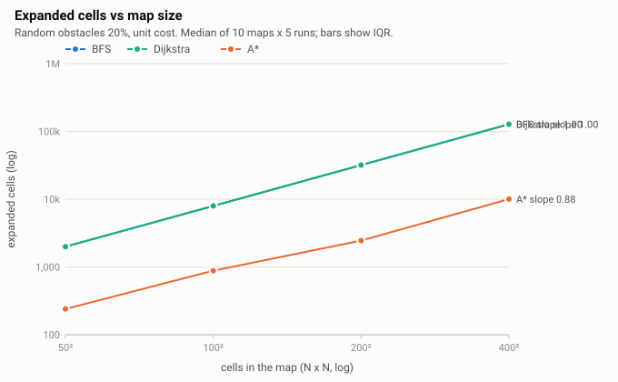
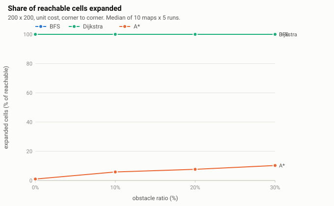
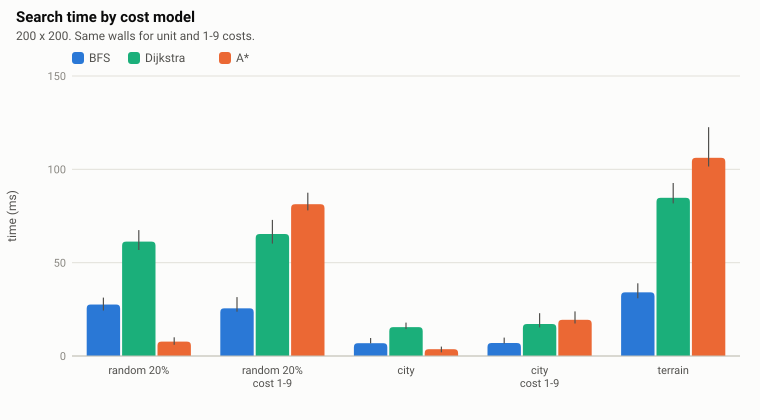
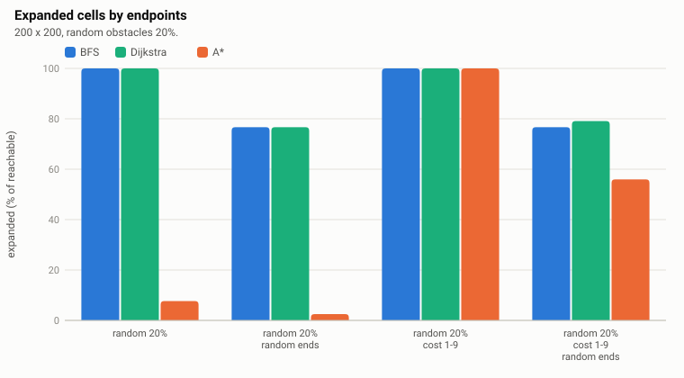
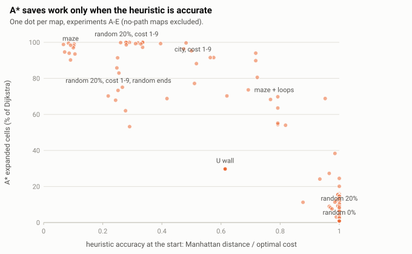
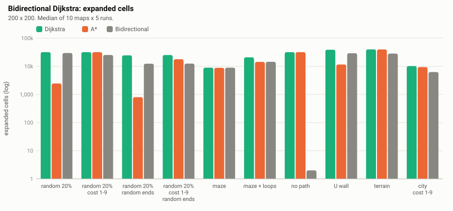
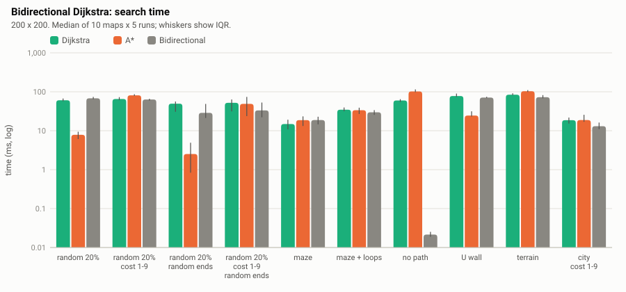
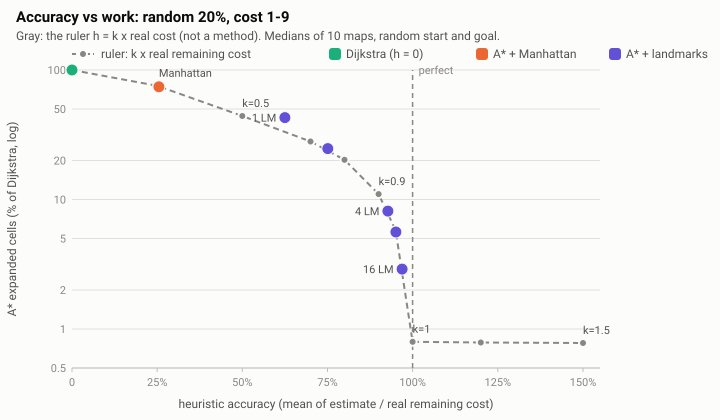
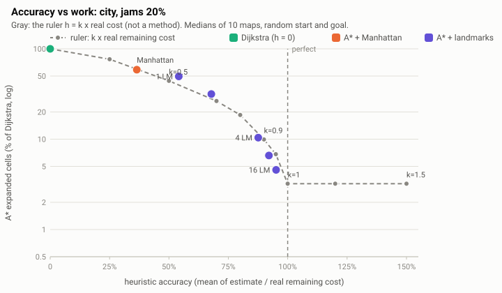
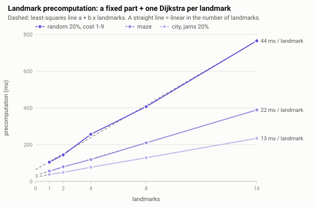

# Experiment results

Generated by `make analyze` from the raw data in `results/`. Times are medians over 10 maps x 5 runs with the interquartile range (IQR) in brackets.

Measured on GitHub Codespaces: AMD EPYC 7763 64-Core Processor, 2 CPUs, Python 3.13.5, commit `d281114`.

## A. Map size

Slope on the log-log chart: 1 means time grows in proportion to the number of cells.

| algorithm | slope of time | slope of expanded |
| --- | ---: | ---: |
| BFS | 0.93 | 1.00 |
| Dijkstra | 0.96 | 1.00 |
| A* | 0.83 | 0.88 |

| condition | algorithm | time ms, median [IQR] | expanded | of reachable | stale | max frontier | cost / optimal | us per cell |
| --- | --- | ---: | ---: | ---: | ---: | ---: | ---: | ---: |
| random 20%, 50x50 | BFS | 2.44 [2.40-2.51] | 1,995 | 100% | 0 | 50 | 1.000 | 1.22 |
| random 20%, 50x50 | Dijkstra | 5.45 [5.29-5.65] | 1,995 | 100% | 0 | 50 | 1.000 | 2.75 |
| random 20%, 50x50 | A* | 1.01 [0.84-1.36] | 240 | 12% | 0 | 161 | 1.000 | 4.88 |
| random 20%, 100x100 | BFS | 7.32 [5.87-9.43] | 7,954 | 100% | 0 | 98 | 1.000 | 0.92 |
| random 20%, 100x100 | Dijkstra | 16.74 [13.22-22.30] | 7,954 | 100% | 0 | 98 | 1.000 | 2.11 |
| random 20%, 100x100 | A* | 2.84 [2.15-4.16] | 880 | 11% | 0 | 558 | 1.000 | 2.73 |
| random 20%, 200x200 | BFS | 26.53 [24.37-32.21] | 31,903 | 100% | 0 | 188 | 1.000 | 0.83 |
| random 20%, 200x200 | Dijkstra | 64.02 [60.79-74.78] | 31,903 | 100% | 0 | 188 | 1.000 | 2.01 |
| random 20%, 200x200 | A* | 8.47 [6.27-10.27] | 2,450 | 8% | 0 | 1,464 | 1.000 | 3.07 |
| random 20%, 400x400 | BFS | 115.35 [112.17-121.33] | 127,658 | 100% | 0 | 369 | 1.000 | 0.90 |
| random 20%, 400x400 | Dijkstra | 289.09 [273.40-320.92] | 127,658 | 100% | 0 | 369 | 1.000 | 2.27 |
| random 20%, 400x400 | A* | 32.49 [24.35-39.29] | 10,025 | 8% | 0 | 5,716 | 1.000 | 3.30 |

## B. Obstacle ratio

| condition | algorithm | time ms, median [IQR] | expanded | of reachable | stale | max frontier | cost / optimal | us per cell |
| --- | --- | ---: | ---: | ---: | ---: | ---: | ---: | ---: |
| random 0% | BFS | 34.67 [30.85-39.96] | 40,000 | 100% | 0 | 200 | 1.000 | 0.87 |
| random 0% | Dijkstra | 77.17 [73.94-79.38] | 40,000 | 100% | 0 | 200 | 1.000 | 1.93 |
| random 0% | A* | 1.16 [1.15-1.80] | 399 | 1% | 0 | 397 | 1.000 | 2.92 |
| random 10% | BFS | 31.05 [27.68-34.66] | 35,998 | 100% | 0 | 200 | 1.000 | 0.86 |
| random 10% | Dijkstra | 68.10 [63.30-72.66] | 35,998 | 100% | 0 | 200 | 1.000 | 1.89 |
| random 10% | A* | 6.34 [5.50-9.05] | 2,106 | 6% | 0 | 1,676 | 1.000 | 2.90 |
| random 20% | BFS | 27.03 [24.05-30.86] | 31,903 | 100% | 0 | 188 | 1.000 | 0.85 |
| random 20% | Dijkstra | 62.68 [58.10-68.08] | 31,903 | 100% | 0 | 188 | 1.000 | 1.96 |
| random 20% | A* | 8.02 [6.10-10.90] | 2,450 | 8% | 0 | 1,464 | 1.000 | 2.85 |
| random 30% | BFS | 23.02 [20.34-28.07] | 27,430 | 100% | 0 | 174 | 1.000 | 0.84 |
| random 30% | Dijkstra | 53.68 [49.49-56.13] | 27,430 | 100% | 0 | 174 | 1.000 | 1.95 |
| random 30% | A* | 8.13 [6.24-10.61] | 2,834 | 10% | 4 | 1,178 | 1.000 | 2.55 |

## C. Map kind

| condition | algorithm | time ms, median [IQR] | expanded | of reachable | stale | max frontier | cost / optimal | us per cell |
| --- | --- | ---: | ---: | ---: | ---: | ---: | ---: | ---: |
| random 20% | BFS | 25.43 [23.59-30.73] | 31,903 | 100% | 0 | 188 | 1.000 | 0.80 |
| random 20% | Dijkstra | 62.27 [58.33-67.91] | 31,903 | 100% | 0 | 188 | 1.000 | 1.95 |
| random 20% | A* | 8.19 [6.25-10.01] | 2,450 | 8% | 0 | 1,464 | 1.000 | 2.72 |
| maze | BFS | 9.35 [6.45-11.81] | 8,953 | 45% | 0 | 12 | 1.000 | 0.84 |
| maze | Dijkstra | 16.03 [11.12-18.94] | 8,953 | 45% | 0 | 12 | 1.000 | 1.44 |
| maze | A* | 18.87 [14.53-24.04] | 8,832 | 44% | 0 | 11 | 1.000 | 1.82 |
| maze + loops | BFS | 14.51 [14.16-18.10] | 20,862 | 100% | 0 | 106 | 1.000 | 0.69 |
| maze + loops | Dijkstra | 38.06 [33.79-42.25] | 20,862 | 100% | 0 | 106 | 1.000 | 1.83 |
| maze + loops | A* | 32.10 [28.10-41.00] | 14,346 | 68% | 572 | 227 | 1.000 | 2.27 |
| no path | BFS | 27.26 [23.32-30.16] | 31,900 | 100% | 0 | 188 | - | 0.85 |
| no path | Dijkstra | 59.99 [53.53-71.22] | 31,900 | 100% | 0 | 188 | - | 1.88 |
| no path | A* | 102.22 [98.46-111.01] | 31,900 | 100% | 12,330 | 10,513 | - | 3.20 |
| U wall | BFS | 36.09 [30.61-40.98] | 38,919 | 98% | 0 | 239 | 1.000 | 0.93 |
| U wall | Dijkstra | 75.92 [71.18-82.32] | 38,919 | 98% | 0 | 239 | 1.000 | 1.95 |
| U wall | A* | 24.69 [23.12-31.97] | 11,572 | 29% | 0 | 347 | 1.000 | 2.13 |
| city | BFS | 7.27 [6.74-9.87] | 10,232 | 100% | 0 | 74 | 1.000 | 0.71 |
| city | Dijkstra | 15.39 [14.50-18.31] | 10,232 | 100% | 0 | 74 | 1.000 | 1.51 |
| city | A* | 4.45 [2.18-7.35] | 1,506 | 15% | 0 | 156 | 1.000 | 1.96 |

## D. Cost model

| condition | algorithm | time ms, median [IQR] | expanded | of reachable | stale | max frontier | cost / optimal | us per cell |
| --- | --- | ---: | ---: | ---: | ---: | ---: | ---: | ---: |
| random 20% | BFS | 27.60 [24.36-31.28] | 31,903 | 100% | 0 | 188 | 1.000 | 0.86 |
| random 20% | Dijkstra | 61.31 [56.79-67.43] | 31,903 | 100% | 0 | 188 | 1.000 | 1.93 |
| random 20% | A* | 7.73 [5.99-10.02] | 2,450 | 8% | 0 | 1,464 | 1.000 | 2.77 |
| random 20%, cost 1-9 | BFS | 25.56 [23.71-31.58] | 31,903 | 100% | 0 | 188 | 1.421 | 0.80 |
| random 20%, cost 1-9 | Dijkstra | 65.35 [60.20-72.92] | 31,898 | 100% | 0 | 272 | 1.000 | 2.05 |
| random 20%, cost 1-9 | A* | 81.33 [77.98-87.50] | 31,897 | 100% | 1,794 | 366 | 1.000 | 2.55 |
| city | BFS | 6.87 [6.76-9.65] | 10,232 | 100% | 0 | 74 | 1.000 | 0.67 |
| city | Dijkstra | 15.51 [14.51-17.88] | 10,232 | 100% | 0 | 74 | 1.000 | 1.51 |
| city | A* | 3.64 [1.99-5.05] | 1,506 | 15% | 0 | 156 | 1.000 | 1.95 |
| city, cost 1-9 | BFS | 6.97 [6.71-9.87] | 10,232 | 100% | 0 | 74 | 1.413 | 0.68 |
| city, cost 1-9 | Dijkstra | 17.14 [15.34-22.93] | 10,225 | 100% | 0 | 94 | 1.000 | 1.71 |
| city, cost 1-9 | A* | 19.37 [17.42-23.89] | 9,383 | 91% | 84 | 143 | 1.000 | 2.09 |
| terrain | BFS | 34.14 [30.93-38.96] | 40,000 | 100% | 0 | 200 | 1.500 | 0.85 |
| terrain | Dijkstra | 84.74 [81.73-92.68] | 40,000 | 100% | 0 | 330 | 1.000 | 2.13 |
| terrain | A* | 106.19 [101.54-122.57] | 39,888 | 100% | 2,994 | 494 | 1.000 | 2.66 |

## E. Fixed vs random endpoints

| condition | algorithm | time ms, median [IQR] | expanded | of reachable | stale | max frontier | cost / optimal | us per cell |
| --- | --- | ---: | ---: | ---: | ---: | ---: | ---: | ---: |
| random 20% | BFS | 25.96 [23.67-30.34] | 31,903 | 100% | 0 | 188 | 1.000 | 0.81 |
| random 20% | Dijkstra | 61.18 [58.70-64.90] | 31,903 | 100% | 0 | 188 | 1.000 | 1.92 |
| random 20% | A* | 8.79 [5.89-10.95] | 2,450 | 8% | 0 | 1,464 | 1.000 | 2.88 |
| random 20%, random ends | BFS | 20.11 [14.36-23.44] | 24,459 | 77% | 0 | 212 | 1.000 | 0.81 |
| random 20%, random ends | Dijkstra | 49.55 [32.30-59.18] | 24,459 | 77% | 0 | 212 | 1.000 | 1.97 |
| random 20%, random ends | A* | 2.14 [0.71-5.59] | 802 | 3% | 0 | 302 | 1.000 | 3.12 |
| random 20%, cost 1-9 | BFS | 24.53 [23.30-31.81] | 31,903 | 100% | 0 | 188 | 1.421 | 0.77 |
| random 20%, cost 1-9 | Dijkstra | 65.56 [62.95-70.23] | 31,898 | 100% | 0 | 272 | 1.000 | 2.06 |
| random 20%, cost 1-9 | A* | 82.27 [79.38-91.14] | 31,897 | 100% | 1,794 | 366 | 1.000 | 2.58 |
| random 20%, cost 1-9, random ends | BFS | 20.01 [12.94-22.98] | 24,459 | 77% | 0 | 212 | 1.286 | 0.77 |
| random 20%, cost 1-9, random ends | Dijkstra | 54.04 [38.90-64.46] | 25,232 | 79% | 0 | 284 | 1.000 | 2.18 |
| random 20%, cost 1-9, random ends | A* | 47.90 [23.84-65.40] | 17,848 | 56% | 1,092 | 336 | 1.000 | 2.62 |

## Time decomposition

| algorithm | us per cell, unit cost | us per cell, cost 1-9 |
| --- | ---: | ---: |
| BFS | 0.85 | 0.78 |
| Dijkstra | 1.94 | 2.08 |
| A* | 2.86 | 2.57 |

## Heuristic accuracy

Accuracy 1 means the Manhattan distance equals the real remaining cost; with costs 1-9 it is about 1/5, and A* expands almost as much as Dijkstra.

## Measurement noise

| algorithm | median ms | IQR / median | min | max |
| --- | ---: | ---: | ---: | ---: |
| BFS | 28.06 | 36.6% | 23.04 | 50.35 |
| Dijkstra | 62.76 | 12.7% | 52.06 | 109.62 |
| A* | 5.25 | 42.3% | 5.08 | 13.15 |

## T. A* tie-breaking

| condition | algorithm | time ms, median [IQR] | expanded | of reachable | stale | max frontier | cost / optimal | us per cell |
| --- | --- | ---: | ---: | ---: | ---: | ---: | ---: | ---: |
| random 0% | larger g first | 1.17 [1.15-1.18] | 399 | 1% | 0 | 397 | 1.000 | 2.92 |
| random 0% | smaller g first | 88.53 [86.92-96.85] | 40,000 | 100% | 0 | 200 | 1.000 | 2.21 |
| random 0% | insertion order | 87.61 [85.76-92.44] | 40,000 | 100% | 0 | 200 | 1.000 | 2.19 |
| random 10% | larger g first | 6.57 [5.91-9.25] | 2,106 | 6% | 0 | 1,676 | 1.000 | 2.93 |
| random 10% | smaller g first | 73.60 [67.20-79.45] | 30,604 | 85% | 0 | 742 | 1.000 | 2.41 |
| random 10% | insertion order | 71.59 [67.72-75.96] | 30,604 | 85% | 0 | 742 | 1.000 | 2.37 |
| random 20% | larger g first | 7.13 [6.07-10.10] | 2,450 | 8% | 0 | 1,464 | 1.000 | 2.69 |
| random 20% | smaller g first | 48.40 [43.31-56.40] | 19,572 | 61% | 0 | 1,420 | 1.000 | 2.52 |
| random 20% | insertion order | 48.82 [40.82-55.25] | 19,572 | 61% | 0 | 1,420 | 1.000 | 2.43 |
| city | larger g first | 2.90 [2.05-5.16] | 1,506 | 15% | 0 | 156 | 1.000 | 1.93 |
| city | smaller g first | 8.58 [6.48-11.82] | 4,176 | 41% | 0 | 188 | 1.000 | 1.79 |
| city | insertion order | 7.89 [6.30-12.31] | 4,176 | 41% | 0 | 188 | 1.000 | 1.77 |
| random 20%, cost 1-9 | larger g first | 80.86 [77.75-85.67] | 31,897 | 100% | 1,794 | 366 | 1.000 | 2.53 |
| random 20%, cost 1-9 | smaller g first | 78.01 [74.44-86.58] | 31,898 | 100% | 868 | 350 | 1.000 | 2.44 |
| random 20%, cost 1-9 | insertion order | 78.28 [75.00-83.19] | 31,898 | 100% | 1,230 | 352 | 1.000 | 2.45 |

## W. Weighted A*

| condition | algorithm | time ms, median [IQR] | expanded | of reachable | stale | max frontier | cost / optimal | us per cell |
| --- | --- | ---: | ---: | ---: | ---: | ---: | ---: | ---: |
| random 20% | dijkstra | 60.81 [57.53-67.59] | 31,903 | 100% | 0 | 188 | 1.000 | 1.91 |
| random 20% | A* x1 | 6.78 [5.84-9.66] | 2,450 | 8% | 0 | 1,464 | 1.000 | 2.63 |
| random 20% | A* x1.5 | 1.82 [1.63-2.06] | 634 | 2% | 24 | 436 | 1.091 | 2.77 |
| random 20% | A* x2 | 1.57 [1.52-1.74] | 567 | 2% | 10 | 432 | 1.127 | 2.72 |
| random 20% | A* x3 | 1.48 [1.44-2.09] | 545 | 2% | 0 | 434 | 1.156 | 2.73 |
| random 20% | A* x5 | 1.47 [1.41-2.02] | 534 | 2% | 0 | 436 | 1.165 | 2.72 |
| random 20%, cost 1-9 | dijkstra | 66.44 [62.04-74.62] | 31,898 | 100% | 0 | 272 | 1.000 | 2.08 |
| random 20%, cost 1-9 | A* x1 | 79.33 [76.04-84.80] | 31,897 | 100% | 1,794 | 366 | 1.000 | 2.49 |
| random 20%, cost 1-9 | A* x1.5 | 84.54 [81.17-91.84] | 31,893 | 100% | 2,700 | 432 | 1.000 | 2.65 |
| random 20%, cost 1-9 | A* x2 | 86.01 [83.28-91.97] | 31,886 | 100% | 3,790 | 545 | 1.001 | 2.69 |
| random 20%, cost 1-9 | A* x3 | 78.41 [73.28-83.57] | 26,521 | 83% | 4,758 | 1,039 | 1.006 | 2.96 |
| random 20%, cost 1-9 | A* x5 | 1.88 [1.61-2.75] | 600 | 2% | 7 | 469 | 1.132 | 2.89 |
| terrain | dijkstra | 83.80 [81.66-88.58] | 40,000 | 100% | 0 | 330 | 1.000 | 2.10 |
| terrain | A* x1 | 103.11 [98.93-114.33] | 39,888 | 100% | 2,994 | 494 | 1.000 | 2.58 |
| terrain | A* x1.5 | 105.24 [100.70-113.29] | 39,492 | 99% | 5,029 | 593 | 1.000 | 2.69 |
| terrain | A* x2 | 109.64 [102.87-118.24] | 38,158 | 95% | 7,335 | 882 | 1.019 | 2.87 |
| terrain | A* x3 | 103.07 [80.52-118.83] | 28,876 | 72% | 9,828 | 1,728 | 1.071 | 3.19 |
| terrain | A* x5 | 4.69 [1.69-15.31] | 1,336 | 3% | 241 | 1,186 | 1.234 | 3.07 |
| U wall | dijkstra | 78.04 [75.43-79.91] | 38,919 | 98% | 0 | 239 | 1.000 | 2.01 |
| U wall | A* x1 | 24.18 [22.07-29.38] | 11,572 | 29% | 0 | 347 | 1.000 | 2.09 |
| U wall | A* x1.5 | 25.55 [22.67-29.79] | 11,012 | 28% | 0 | 347 | 1.000 | 2.32 |
| U wall | A* x2 | 24.58 [21.41-30.17] | 10,558 | 27% | 0 | 347 | 1.000 | 2.33 |
| U wall | A* x3 | 22.28 [20.36-28.52] | 10,052 | 25% | 0 | 347 | 1.000 | 2.22 |
| U wall | A* x5 | 21.17 [19.33-27.42] | 9,518 | 24% | 0 | 347 | 1.000 | 2.22 |
| city, cost 1-9 | dijkstra | 15.95 [15.26-21.98] | 10,225 | 100% | 0 | 94 | 1.000 | 1.60 |
| city, cost 1-9 | A* x1 | 17.81 [16.77-24.27] | 9,383 | 91% | 84 | 143 | 1.000 | 1.95 |
| city, cost 1-9 | A* x1.5 | 13.65 [11.52-18.11] | 6,381 | 62% | 66 | 136 | 1.008 | 2.02 |
| city, cost 1-9 | A* x2 | 6.35 [4.50-10.71] | 3,001 | 29% | 39 | 128 | 1.028 | 1.88 |
| city, cost 1-9 | A* x3 | 2.39 [1.70-2.96] | 929 | 9% | 8 | 106 | 1.148 | 1.88 |
| city, cost 1-9 | A* x5 | 1.67 [1.37-2.10] | 776 | 8% | 4 | 97 | 1.295 | 1.90 |

## H. heapq vs plain-Python heap

| condition | algorithm | heapq ms | Python heap ms | slower by |
| --- | ---: | ---: | ---: | ---: |
| random 20% 200² | Dijkstra | 62.50 | 97.82 | 1.57x |
| random 20% 200² | A* | 7.92 | 13.61 | 1.72x |
| random 20%, cost 1-9 200² | Dijkstra | 65.68 | 104.34 | 1.59x |
| random 20%, cost 1-9 200² | A* | 79.37 | 131.45 | 1.66x |
| random 20% 400² | Dijkstra | 295.32 | 471.52 | 1.60x |
| random 20% 400² | A* | 30.75 | 67.33 | 2.19x |

## BI. Bidirectional Dijkstra

| condition | algorithm | time ms, median [IQR] | expanded | of reachable | stale | max frontier | cost / optimal | us per cell |
| --- | --- | ---: | ---: | ---: | ---: | ---: | ---: | ---: |
| random 20% | Dijkstra | 60.58 [57.37-67.17] | 31,903 | 100% | 0 | 188 | 1.000 | 1.90 |
| random 20% | A* | 7.85 [6.09-9.40] | 2,450 | 8% | 0 | 1,464 | 1.000 | 2.71 |
| random 20% | Bidirectional | 68.07 [64.74-73.69] | 29,748 | 93% | 0 | 326 | 1.000 | 2.29 |
| random 20%, cost 1-9 | Dijkstra | 65.31 [60.73-72.73] | 31,898 | 100% | 0 | 272 | 1.000 | 2.05 |
| random 20%, cost 1-9 | A* | 80.99 [78.24-86.64] | 31,897 | 100% | 1,794 | 366 | 1.000 | 2.55 |
| random 20%, cost 1-9 | Bidirectional | 63.47 [59.34-66.08] | 25,286 | 79% | 2,011 | 429 | 1.000 | 2.49 |
| random 20%, random ends | Dijkstra | 49.44 [30.63-56.26] | 24,459 | 77% | 0 | 212 | 1.000 | 1.99 |
| random 20%, random ends | A* | 2.52 [0.83-4.91] | 802 | 3% | 0 | 302 | 1.000 | 3.06 |
| random 20%, random ends | Bidirectional | 28.73 [21.22-48.73] | 12,408 | 39% | 0 | 329 | 1.000 | 2.30 |
| random 20%, cost 1-9, random ends | Dijkstra | 51.93 [31.37-63.34] | 25,232 | 79% | 0 | 284 | 1.000 | 2.08 |
| random 20%, cost 1-9, random ends | A* | 48.87 [23.68-73.72] | 17,848 | 56% | 1,092 | 336 | 1.000 | 2.64 |
| random 20%, cost 1-9, random ends | Bidirectional | 33.23 [22.13-52.89] | 12,486 | 39% | 1,564 | 428 | 1.000 | 2.49 |
| maze | Dijkstra | 14.83 [10.81-19.17] | 8,953 | 45% | 0 | 12 | 1.000 | 1.35 |
| maze | A* | 18.65 [13.21-23.28] | 8,832 | 44% | 0 | 11 | 1.000 | 1.90 |
| maze | Bidirectional | 18.79 [14.55-22.82] | 8,958 | 45% | 0 | 20 | 1.000 | 1.70 |
| maze + loops | Dijkstra | 34.60 [31.68-39.47] | 20,862 | 100% | 0 | 106 | 1.000 | 1.66 |
| maze + loops | A* | 33.60 [26.95-39.02] | 14,346 | 68% | 572 | 227 | 1.000 | 2.21 |
| maze + loops | Bidirectional | 29.68 [25.50-33.78] | 14,500 | 69% | 0 | 146 | 1.000 | 1.99 |
| no path | Dijkstra | 59.72 [54.57-64.52] | 31,900 | 100% | 0 | 188 | - | 1.87 |
| no path | A* | 102.18 [97.43-115.17] | 31,900 | 100% | 12,330 | 10,513 | - | 3.20 |
| no path | Bidirectional | 0.02 [0.02-0.03] | 2 | 0% | 0 | 3 | - | 9.43 |
| U wall | Dijkstra | 77.66 [73.84-89.87] | 38,919 | 98% | 0 | 239 | 1.000 | 2.00 |
| U wall | A* | 24.52 [23.15-31.52] | 11,572 | 29% | 0 | 347 | 1.000 | 2.12 |
| U wall | Bidirectional | 71.20 [68.85-74.35] | 29,129 | 73% | 0 | 357 | 1.000 | 2.44 |
| terrain | Dijkstra | 83.98 [81.29-91.18] | 40,000 | 100% | 0 | 330 | 1.000 | 2.10 |
| terrain | A* | 103.36 [98.87-110.30] | 39,888 | 100% | 2,994 | 494 | 1.000 | 2.60 |
| terrain | Bidirectional | 72.66 [67.90-82.01] | 28,242 | 71% | 335 | 484 | 1.000 | 2.49 |
| city, cost 1-9 | Dijkstra | 18.62 [15.29-21.72] | 10,225 | 100% | 0 | 94 | 1.000 | 1.81 |
| city, cost 1-9 | A* | 18.75 [16.91-25.60] | 9,383 | 91% | 84 | 143 | 1.000 | 2.09 |
| city, cost 1-9 | Bidirectional | 13.05 [11.00-16.15] | 6,263 | 61% | 10 | 124 | 1.000 | 1.93 |

## O. 8-directional moves and Jump Point Search

Costs are in 8-direction units (straight step 10, diagonal 14). JPS puts only jump points on the heap but scans many cells in between.

| condition | JPS jump points | JPS cells scanned | A* expanded | JPS ms | A* ms |
| --- | ---: | ---: | ---: | ---: | ---: |
| random 0% | 2 | 39,999 | 200 | 45.01 | 1.50 |
| random 20% | 6,512 | 51,430 | 11,522 | 89.39 | 51.95 |
| maze | 2,644 | 8,843 | 8,840 | 19.74 | 20.10 |
| no path | 18,492 | 146,092 | 31,900 | 252.77 | 137.26 |
| U wall | 7 | 43,563 | 10,224 | 50.58 | 66.41 |
| city | 600 | 9,608 | 7,428 | 11.96 | 18.14 |

| condition | algorithm | time ms, median [IQR] | expanded | of reachable | stale | max frontier | cost / optimal | us per cell |
| --- | --- | ---: | ---: | ---: | ---: | ---: | ---: | ---: |
| random 0% | BFS | 71.29 [69.28-73.70] | 40,000 | 100% | 0 | 399 | 1.000 | 1.78 |
| random 0% | Dijkstra | 135.59 [129.20-155.43] | 40,000 | 100% | 0 | 399 | 1.000 | 3.39 |
| random 0% | A* | 1.50 [1.48-2.31] | 200 | 0% | 0 | 795 | 1.000 | 7.51 |
| random 0% | Bidirectional | 124.64 [118.95-145.62] | 27,960 | 70% | 0 | 562 | 1.000 | 4.46 |
| random 0% | JPS | 45.01 [41.62-48.21] | 2 | 0% | 0 | 1 | 1.000 | 22506.73 |
| random 20% | BFS | 43.98 [40.77-47.97] | 31,901 | 100% | 0 | 288 | 1.001 | 1.38 |
| random 20% | Dijkstra | 94.16 [91.60-105.87] | 31,902 | 100% | 506 | 291 | 1.000 | 2.96 |
| random 20% | A* | 51.95 [47.07-57.35] | 11,522 | 36% | 4,870 | 938 | 1.000 | 4.49 |
| random 20% | Bidirectional | 92.45 [88.90-98.11] | 25,408 | 80% | 408 | 434 | 1.000 | 3.64 |
| random 20% | JPS | 89.39 [85.80-99.18] | 6,512 | 20% | 1,344 | 624 | 1.000 | 13.55 |
| maze | BFS | 11.43 [7.91-12.64] | 8,953 | 45% | 0 | 12 | 1.000 | 0.99 |
| maze | Dijkstra | 17.50 [12.57-23.07] | 8,953 | 45% | 0 | 12 | 1.000 | 1.68 |
| maze | A* | 20.10 [15.10-23.78] | 8,840 | 44% | 0 | 12 | 1.000 | 1.91 |
| maze | Bidirectional | 20.09 [17.90-24.35] | 8,958 | 45% | 0 | 20 | 1.000 | 2.07 |
| maze | JPS | 19.74 [14.76-24.30] | 2,644 | 13% | 0 | 8 | 1.000 | 6.52 |
| no path | BFS | 44.74 [40.46-49.46] | 31,900 | 100% | 0 | 288 | - | 1.40 |
| no path | Dijkstra | 94.17 [91.17-103.84] | 31,900 | 100% | 506 | 291 | - | 2.95 |
| no path | A* | 137.26 [131.72-150.13] | 31,900 | 100% | 13,744 | 938 | - | 4.29 |
| no path | Bidirectional | 0.02 [0.02-0.03] | 2 | 0% | 0 | 4 | - | 9.90 |
| no path | JPS | 252.77 [242.82-269.31] | 18,492 | 58% | 4,467 | 648 | - | 13.60 |
| U wall | BFS | 64.07 [59.72-65.72] | 35,680 | 90% | 0 | 414 | 1.000 | 1.80 |
| U wall | Dijkstra | 133.77 [129.15-148.81] | 37,562 | 94% | 0 | 436 | 1.000 | 3.56 |
| U wall | A* | 66.41 [60.81-72.71] | 10,224 | 26% | 15,865 | 1,375 | 1.000 | 6.50 |
| U wall | Bidirectional | 142.24 [138.81-158.85] | 29,412 | 74% | 0 | 629 | 1.000 | 4.84 |
| U wall | JPS | 50.58 [47.67-53.73] | 7 | 0% | 0 | 3 | 1.000 | 7225.11 |
| city | BFS | 8.11 [7.87-11.59] | 10,232 | 100% | 0 | 74 | 1.000 | 0.79 |
| city | Dijkstra | 18.38 [16.13-22.81] | 10,232 | 100% | 0 | 74 | 1.000 | 1.83 |
| city | A* | 18.14 [15.70-21.18] | 7,428 | 73% | 180 | 120 | 1.000 | 2.31 |
| city | Bidirectional | 16.24 [15.64-18.26] | 8,212 | 80% | 0 | 120 | 1.000 | 1.97 |
| city | JPS | 11.96 [10.51-14.04] | 600 | 6% | 29 | 71 | 1.000 | 18.61 |
| random 20%, cost 1-9 | BFS | 44.34 [40.66-48.45] | 31,901 | 100% | 0 | 288 | 1.436 | 1.39 |
| random 20%, cost 1-9 | Dijkstra | 106.18 [100.20-115.98] | 31,896 | 100% | 4,930 | 481 | 1.000 | 3.34 |
| random 20%, cost 1-9 | A* | 128.90 [124.98-136.44] | 31,876 | 100% | 6,084 | 598 | 1.000 | 4.04 |
| random 20%, cost 1-9 | Bidirectional | 97.68 [93.92-105.49] | 23,792 | 75% | 5,872 | 697 | 1.000 | 4.09 |

## J. Traffic jams

| condition | algorithm | time ms, median [IQR] | expanded | of reachable | stale | max frontier | cost / optimal | us per cell |
| --- | --- | ---: | ---: | ---: | ---: | ---: | ---: | ---: |
| jams 0% | BFS | 6.86 [6.78-8.09] | 10,232 | 100% | 0 | 74 | 1.000 | 0.67 |
| jams 0% | Dijkstra | 14.83 [14.51-20.76] | 10,232 | 100% | 0 | 74 | 1.000 | 1.45 |
| jams 0% | A* | 3.63 [2.21-5.02] | 1,506 | 15% | 0 | 156 | 1.000 | 1.96 |
| jams 0% | Bidirectional | 15.19 [13.70-20.35] | 8,212 | 80% | 0 | 120 | 1.000 | 1.88 |
| jams 1% | BFS | 6.89 [6.80-9.44] | 10,232 | 100% | 0 | 74 | 1.050 | 0.67 |
| jams 1% | Dijkstra | 14.95 [14.72-18.35] | 10,228 | 100% | 0 | 74 | 1.000 | 1.46 |
| jams 1% | A* | 5.34 [2.75-7.89] | 2,728 | 27% | 62 | 180 | 1.000 | 1.94 |
| jams 1% | Bidirectional | 13.71 [13.03-17.28] | 7,820 | 76% | 5 | 125 | 1.000 | 1.71 |
| jams 2% | BFS | 7.26 [6.82-8.80] | 10,232 | 100% | 0 | 74 | 1.097 | 0.71 |
| jams 2% | Dijkstra | 16.67 [15.01-18.13] | 10,232 | 100% | 0 | 78 | 1.000 | 1.63 |
| jams 2% | A* | 7.09 [2.90-11.64] | 3,558 | 35% | 74 | 165 | 1.000 | 2.06 |
| jams 2% | Bidirectional | 14.03 [13.24-16.58] | 7,662 | 75% | 12 | 122 | 1.000 | 1.86 |
| jams 5% | BFS | 6.85 [6.78-8.08] | 10,232 | 100% | 0 | 74 | 1.194 | 0.67 |
| jams 5% | Dijkstra | 15.39 [15.07-18.70] | 10,218 | 100% | 0 | 78 | 1.000 | 1.51 |
| jams 5% | A* | 12.30 [9.03-15.30] | 5,313 | 52% | 100 | 199 | 1.000 | 1.97 |
| jams 5% | Bidirectional | 12.88 [12.17-15.31] | 7,182 | 70% | 22 | 127 | 1.000 | 1.76 |
| jams 10% | BFS | 6.83 [6.76-7.46] | 10,232 | 100% | 0 | 74 | 1.244 | 0.66 |
| jams 10% | Dijkstra | 16.18 [15.01-21.17] | 10,210 | 100% | 0 | 78 | 1.000 | 1.59 |
| jams 10% | A* | 15.91 [11.52-20.86] | 7,939 | 77% | 124 | 159 | 1.000 | 1.95 |
| jams 10% | Bidirectional | 12.32 [11.13-13.91] | 7,043 | 69% | 34 | 114 | 1.000 | 1.74 |
| jams 20% | BFS | 6.92 [6.78-7.82] | 10,232 | 100% | 0 | 74 | 1.204 | 0.67 |
| jams 20% | Dijkstra | 15.93 [15.29-19.55] | 10,227 | 100% | 0 | 77 | 1.000 | 1.55 |
| jams 20% | A* | 19.81 [18.64-24.13] | 9,864 | 98% | 122 | 114 | 1.000 | 2.01 |
| jams 20% | Bidirectional | 13.62 [12.04-16.50] | 7,098 | 69% | 42 | 117 | 1.000 | 1.78 |
| jams 30% | BFS | 6.87 [6.78-9.26] | 10,232 | 100% | 0 | 74 | 1.199 | 0.67 |
| jams 30% | Dijkstra | 15.58 [15.20-17.77] | 10,225 | 100% | 0 | 74 | 1.000 | 1.52 |
| jams 30% | A* | 20.22 [18.52-25.71] | 10,026 | 98% | 94 | 104 | 1.000 | 2.00 |
| jams 30% | Bidirectional | 13.94 [12.99-17.46] | 7,116 | 70% | 48 | 118 | 1.000 | 1.85 |
| jams 50% | BFS | 6.88 [6.78-7.49] | 10,232 | 100% | 0 | 74 | 1.139 | 0.67 |
| jams 50% | Dijkstra | 15.38 [14.96-18.87] | 10,218 | 100% | 0 | 71 | 1.000 | 1.50 |
| jams 50% | A* | 18.75 [18.42-22.73] | 10,152 | 99% | 74 | 82 | 1.000 | 1.84 |
| jams 50% | Bidirectional | 13.62 [12.46-17.39] | 7,320 | 71% | 36 | 111 | 1.000 | 1.77 |

## HQ. Heuristic quality: Manhattan vs landmarks, measured with the accuracy ruler

Accuracy = mean over all cells that can reach the goal of (estimate / real remaining cost). The ruler h = k x real remaining cost needs the answer in advance, so it is a measuring tool, not a competitor. Random start and goal: landmarks are computed once per map and serve any query. Queries to pay off = precomputation time / time saved per query compared with Dijkstra. Precomputation fitted as a + b x landmarks: random 20%, cost 1-9: 65 ms + 51.0 ms per landmark (R² 0.997), maze: 29 ms + 26.7 ms per landmark (R² 0.997), city, jams 20%: 25 ms + 14.5 ms per landmark (R² 0.999).

| map | heuristic | accuracy | cells vs Dijkstra | time ms | precompute ms | queries to pay off (vs Dijkstra) | cost / optimal |
| --- | --- | ---: | ---: | ---: | ---: | ---: | ---: |
| random 20%, cost 1-9 | Dijkstra | 0% | 100.0% | 54.50 | - | - | 1.000 |
| random 20%, cost 1-9 | A* + Manhattan | 26% | 74.2% | 43.17 | - | - | 1.000 |
| random 20%, cost 1-9 | A* + 1 landmarks | 62% | 42.9% | 23.90 | 117.4 | 3.8 | 1.000 |
| random 20%, cost 1-9 | A* + 2 landmarks | 75% | 24.7% | 18.82 | 164.0 | 4.6 | 1.000 |
| random 20%, cost 1-9 | A* + 4 landmarks | 93% | 8.1% | 7.14 | 288.4 | 6.1 | 1.000 |
| random 20%, cost 1-9 | A* + 8 landmarks | 95% | 5.6% | 6.02 | 443.8 | 9.2 | 1.000 |
| random 20%, cost 1-9 | A* + 16 landmarks | 97% | 2.9% | 6.08 | 890.3 | 18.4 | 1.000 |
| random 20%, cost 1-9 | ruler k = 0.25 | 25% | 75.6% | 47.86 | 45.5 | - | 1.000 |
| random 20%, cost 1-9 | ruler k = 0.5 | 50% | 44.1% | 30.46 | 43.9 | - | 1.000 |
| random 20%, cost 1-9 | ruler k = 0.7 | 70% | 28.0% | 16.51 | 47.7 | - | 1.000 |
| random 20%, cost 1-9 | ruler k = 0.8 | 80% | 20.3% | 13.19 | 41.8 | - | 1.000 |
| random 20%, cost 1-9 | ruler k = 0.9 | 90% | 11.0% | 8.04 | 43.7 | - | 1.000 |
| random 20%, cost 1-9 | ruler k = 0.95 | 95% | 5.8% | 4.09 | 42.4 | - | 1.000 |
| random 20%, cost 1-9 | ruler k = 1 | 100% | 0.8% | 0.61 | 40.4 | - | 1.000 |
| random 20%, cost 1-9 | ruler k = 1.2 | 120% | 0.8% | 0.60 | 45.2 | - | 1.000 |
| random 20%, cost 1-9 | ruler k = 1.5 | 150% | 0.8% | 0.72 | 38.9 | - | 1.003 |
| maze | Dijkstra | 0% | 100.0% | 20.64 | - | - | 1.000 |
| maze | A* + Manhattan | 9% | 98.6% | 24.33 | - | - | 1.000 |
| maze | A* + 1 landmarks | 87% | 49.6% | 12.84 | 61.0 | 7.8 | 1.000 |
| maze | A* + 2 landmarks | 98% | 35.2% | 10.38 | 84.0 | 8.2 | 1.000 |
| maze | A* + 4 landmarks | 99% | 30.6% | 10.21 | 137.7 | 13.2 | 1.000 |
| maze | A* + 8 landmarks | 99% | 29.5% | 11.79 | 228.7 | 25.9 | 1.000 |
| maze | A* + 16 landmarks | 99% | 28.7% | 15.47 | 462.5 | 89.5 | 1.000 |
| maze | ruler k = 0.25 | 25% | 90.5% | 20.47 | 21.1 | - | 1.000 |
| maze | ruler k = 0.5 | 50% | 73.3% | 16.19 | 20.2 | - | 1.000 |
| maze | ruler k = 0.7 | 70% | 59.9% | 15.48 | 21.5 | - | 1.000 |
| maze | ruler k = 0.8 | 80% | 52.7% | 11.47 | 25.6 | - | 1.000 |
| maze | ruler k = 0.9 | 90% | 42.1% | 10.14 | 21.6 | - | 1.000 |
| maze | ruler k = 0.95 | 95% | 36.2% | 8.68 | 20.5 | - | 1.000 |
| maze | ruler k = 1 | 100% | 25.2% | 6.30 | 21.9 | - | 1.000 |
| maze | ruler k = 1.2 | 120% | 25.2% | 5.12 | 20.3 | - | 1.000 |
| maze | ruler k = 1.5 | 150% | 25.2% | 6.02 | 25.9 | - | 1.000 |
| city, jams 20% | Dijkstra | 0% | 100.0% | 15.75 | - | - | 1.000 |
| city, jams 20% | A* + Manhattan | 36% | 58.7% | 9.91 | - | - | 1.000 |
| city, jams 20% | A* + 1 landmarks | 54% | 49.5% | 7.43 | 41.2 | 4.9 | 1.000 |
| city, jams 20% | A* + 2 landmarks | 68% | 31.6% | 5.24 | 54.6 | 5.2 | 1.000 |
| city, jams 20% | A* + 4 landmarks | 88% | 10.4% | 2.24 | 83.0 | 6.1 | 1.000 |
| city, jams 20% | A* + 8 landmarks | 92% | 6.6% | 1.87 | 135.9 | 9.8 | 1.000 |
| city, jams 20% | A* + 16 landmarks | 95% | 4.6% | 2.12 | 258.8 | 19.0 | 1.000 |
| city, jams 20% | ruler k = 0.25 | 25% | 76.8% | 13.66 | 12.5 | - | 1.000 |
| city, jams 20% | ruler k = 0.5 | 50% | 44.2% | 8.97 | 13.1 | - | 1.000 |
| city, jams 20% | ruler k = 0.7 | 70% | 26.5% | 4.70 | 13.2 | - | 1.000 |
| city, jams 20% | ruler k = 0.8 | 80% | 18.5% | 3.13 | 12.3 | - | 1.000 |
| city, jams 20% | ruler k = 0.9 | 90% | 9.9% | 1.78 | 13.8 | - | 1.000 |
| city, jams 20% | ruler k = 0.95 | 95% | 6.8% | 1.14 | 16.2 | - | 1.000 |
| city, jams 20% | ruler k = 1 | 100% | 3.2% | 0.53 | 13.3 | - | 1.000 |
| city, jams 20% | ruler k = 1.2 | 120% | 3.2% | 0.60 | 12.4 | - | 1.000 |
| city, jams 20% | ruler k = 1.5 | 150% | 3.2% | 0.48 | 14.3 | - | 1.000 |

## Code size

Lines of code without blank lines, comments and docstrings.

| algorithm | code | lines |
| --- | --- | ---: |
| BFS | `bfs` | 23 |
| Dijkstra | `best_first` + `dijkstra` | 61 |
| A* | `best_first` + `astar` (+ `manhattan`) | 65 |
| Bidirectional Dijkstra | `bidirectional_dijkstra` | 64 |
| JPS | `jump_point_search` + `_expand_path` | 136 |
| A* + landmarks | `best_first` + `LandmarkHeuristic` + `choose_landmarks` + `distances_from` | 122 |
| shared by all | `Grid.neighbors`, `reconstruct_path`, `_trivial` | 35 |

Dijkstra and A* share `best_first`, which also carries the options used in the extra experiments (tie-break, weight, heap choice), so their counts include those lines.
